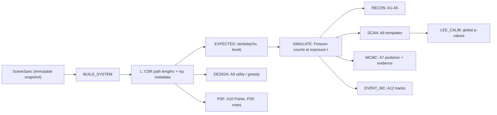

# Architecture

UMBRA is a static, serverless web application: a Rust compute core compiled to
WebAssembly, a TypeScript front end, no backend.

## Layers

| Layer | Technology | Owns | Must not |
|---|---|---|---|
| Presentation | React 19, Tailwind v4, Radix, Framer Motion | Layout, controls, narrative, accessibility | Perform numerics |
| Rendering | Three.js (WebGPU → WebGL2), custom shaders, uPlot | Scene, volume rendering, sky maps, plots | Own application state |
| State | Zustand + Immer, URL codec | Scene, detectors, fidelity, exposure, UI, game | Call WASM directly |
| Orchestration | `ComputeBus`, Comlink | Scheduling, caching, cancellation, progress | Contain science |
| Compute | Rust crates → WASM | Physics, solvers, statistics, design | Touch the DOM |
| Offline tooling | Python, `umbra-cli` | Table generation, oracle, SBC datasets, benchmarks | Ship to the browser except as assets |

## Crates

```text
crates/
  umbra-core      grids, CSR operator + adjoint, primitives, RNG
  umbra-physics   flux tables, CSDA range-energy, scattering, detector, event MC
  umbra-forward   DDA system builder, forward/adjoint model, analytic chords
  umbra-recon     A1-A5 solvers and proximal operators
  umbra-stats     A6/A8/A11 scans, Asimov, LEE, SPRT, bootstrap, SBC
  umbra-infer     A7 ensemble MCMC and nested sampling
  umbra-design    A9 utilities and greedy placement
  umbra-vis       A10 Fisher maps, local PSF, Lanczos modes, coverage roses
  umbra-wasm      wasm-bindgen facade, task entry points
  umbra-cli       native table generation, parity runner, benchmarks
```

Dependency rule:

```text
core ← physics ← forward ← {recon, stats, infer, design, vis} ← wasm
                                            ↖ cli depends on any of the above
```

No cycles. Only `wasm` and `cli` are leaf crates. A shared helper that two sibling
crates need belongs one level lower, not in a new "utils" crate.

## Data flow



The crucial property is that `L` is built **once** per scene and then reused by
every downstream task: reconstruction, anomaly scanning, design and visibility are
all `L` products or adjoints. The problem is data-starved, not compute-starved
(spec §4.8), so the scarce resource is information, not flops.

## Task graph and caching

Each task has a content key — a hash of its inputs — and results are memoised in
memory and, for expensive ones, in IndexedDB. Changing a node invalidates every
descendant; cancellation tokens are checked inside inner loops every ≤ 5 ms, which
bounds UI latency.

| Task | Typical target | Cancellable |
|---|---|---|
| `LOAD_TABLES` | < 50 ms cached | no |
| `BUILD_SYSTEM` | 10 ms (2-D) · 150–500 ms (3-D) | yes |
| `EXPECTED` | 1–5 ms | yes |
| `SIMULATE` | 1–10 ms | yes |
| `RECON` | 20–500 ms (2-D) · 0.5–5 s (3-D) | per iteration |
| `SCAN` | 50 ms (2-D) · 0.3–2 s (3-D) | yes |
| `LEE_CALIB` | 1–10 s, cached | yes |
| `MCMC` | 5–30 s, parallel chains | yes |
| `DESIGN` | 0.2–3 s | yes |
| `PSF` | 5–50 ms | yes |
| `EVENT_MC` | 50–300 ms per 65 k tracks | yes |

Parallelism is **task-parallel**: chains, bootstrap replicates and null datasets
spread across workers. No `SharedArrayBuffer` is required, so GitHub Pages works
without cross-origin isolation. An optional "Turbo" build
(`wasm-bindgen-rayon`, nightly, COOP/COEP) loads only when `crossOriginIsolated`.

## Rust ↔ TypeScript contract

- `wasm-bindgen` for the bridge, `tsify` for generated types.
- Bulk data never crosses through serde: arrays are `Float32Array` /
  `Uint32Array` views over WASM memory, *transferred* to the main thread.
- `api_version()` is exported and asserted by the client at startup; a stale
  cached module fails loudly instead of mismatching silently.
- Errors are a discriminated union `{ ok: true, … } | { ok: false, code, message }`
  (see `web/src/compute/protocol.ts`). No panics cross the boundary.

## Determinism

Seeded counter-based RNG (PCG64-DXSM or Philox-4x32, implemented in-crate). A
stream id is `H(sceneKey, taskKind, index)`, so any task, worker or replicate is
reproducible regardless of scheduling. Exposure scrubbing uses checkpointed
binomial bridging, so counts never decrease with time and scrubbing back
reproduces the same history.

## Budgets

These are design constraints, not aspirations; a PR that breaks one needs to say
so in its description.

| Budget | Target |
|---|---|
| Landing route JS | ≤ 250 KB gzip |
| WASM core | ≤ 700 KB gzip |
| ONNX models (optional) | ≤ 1.5 MB, lazy |
| Slider → redraw | ≤ 100 ms (2-D), ≤ 400 ms (3-D defaults) |
| Lighthouse a11y | ≥ 95 |
| Rust numerics coverage | ≥ 85% lines |

## Invariants

1. `umbra-core` has no dependencies; every crate compiles for
   `wasm32-unknown-unknown`.
2. Every linear operator satisfies the dot-product test in CI.
3. Every analytic chord agrees with voxel-traversal opacity to tolerance (the
   oracle test).
4. `SceneSpec` is immutable; edits produce a new snapshot.
5. Same URL, same universe.
