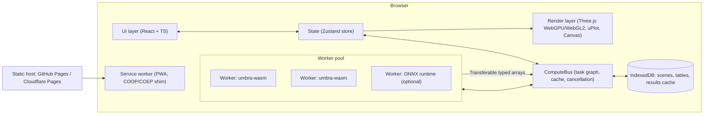
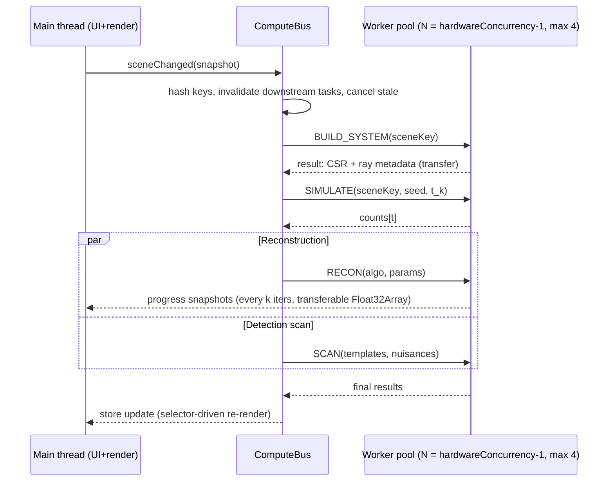
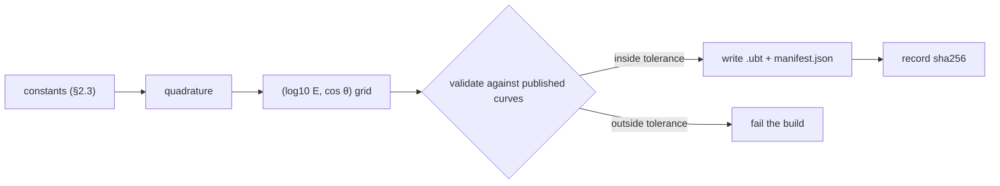
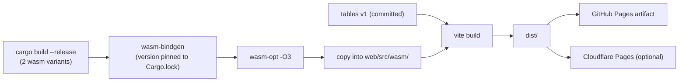

# UMBRA — An Interactive Muon-Tomography Observatory

**Design & Implementation Specification** · v0.2 (draft) · 18 November 2026
**Deliverable:** a static, serverless web application (Rust → WebAssembly compute core, TypeScript/WebGPU front end) hosted on GitHub Pages and/or Cloudflare Pages.

> *Codename "Umbra": the shadow that stone casts in the cosmic-ray sky. The app lets a visitor build a pyramid, hide a chamber in it, place particle detectors, watch muons rain down, and then do real inverse-problem science to decide whether the hidden void can be found, how confident one can be, and where to put the next detector.*

---

## Table of contents

1. [Vision, scope and success criteria](#1-vision-scope-and-success-criteria)
2. [Scientific background and mathematical formulation](#2-scientific-background-and-mathematical-formulation)
3. [Algorithm portfolio (frontier and esoteric components)](#3-algorithm-portfolio-frontier-and-esoteric-components)
4. [System architecture](#4-system-architecture)
5. [Compute core design (Rust/WASM)](#5-compute-core-design-rustwasm)
6. [Offline tooling and the Python reference oracle](#6-offline-tooling-and-the-python-reference-oracle)
7. [Front-end design](#7-front-end-design)
8. [Data, assets and scenario specification](#8-data-assets-and-scenario-specification)
9. [Build, CI/CD, hosting and deployment](#9-build-cicd-hosting-and-deployment)
10. [Testing, validation and benchmarking](#10-testing-validation-and-benchmarking)
11. [Implementation roadmap](#11-implementation-roadmap)
12. [Risk register](#12-risk-register)
13. [Repository layout, documentation and portfolio presentation](#13-repository-layout-documentation-and-portfolio-presentation)
14. [Appendices](#14-appendices)

> **Status of this document.** v0.2 writes the sections v0.1 listed but never
> drafted (§6–§14), so every heading in this contents list now has a body. §11 is
> the roadmap of record; where the text and the code disagree, the code wins and
> the drift is either fixed here or recorded as an ADR. §14.7 is the changelog.

---

## 1. Vision, scope and success criteria

### 1.1 Elevator pitch

Muon radiography images the inside of large structures using cosmic-ray muons. Because muons are absorbed by stone far more than by air, a hidden void shows up as an excess of particles from a particular direction. The 2017 ScanPyramids "Big Void" and the later North Face Corridor were found this way. Umbra turns that into a hands-on instrument:

- **Simulate** the physics (flux, energy loss, detector response, Poisson counting).
- **Reconstruct** density with limited-angle, photon-starved tomography.
- **Decide** statistically whether a void exists, with proper look-elsewhere correction.
- **Design** the experiment by asking where the next detector should go.
- **Play** by finding a hidden chamber in a "Mystery" mode.

### 1.2 Goals

| ID | Goal |
|----|------|
| G1 | A beautiful, fast, fully client-side web app that is understandable in 30 seconds and rewards 30 minutes. |
| G2 | A physically grounded forward model (cosmic-ray flux, energy loss, scattering, detector acceptance) with documented approximations. |
| G3 | A *portfolio* of reconstruction and inference methods that go beyond filtered back projection and are compared on identical data. |
| G4 | Honest statistics: calibrated significance, look-elsewhere correction, nuisance parameters, simulation-based calibration. |
| G5 | Experimental design as a first-class feature (optimal detector placement, time-to-discovery forecasts). |
| G6 | A rigorous engineering baseline: reference oracle, property tests, CI, benchmarks, size budgets, accessibility. |
| G7 | Zero running cost: static hosting, no accounts, no backend, offline-capable PWA. |
| G8 | Reproducibility: every scene and random stream is encoded in a shareable URL. |

### 1.3 Non-goals

- Not a predictor of real chambers in real monuments. Scenarios are schematic and clearly labelled as such.
- Not a full Geant4-class transport code. The physics is a validated *approximation* with documented error.
- No user accounts, server-side compute or paid services in the default deployment.
- No medical or safety-critical use.

### 1.4 Audiences and user journeys

| Persona | Journey | Experience they should have |
|---|---|---|
| Recruiter or engineer (2 min) | Land → scroll story → open Observatory → drag a detector → see the void appear | "This person can ship polished, technical work." |
| Physicist or imaging specialist (15 min) | Lab mode → compare solvers → inspect calibration plots and Methods page | "The statistics and inverse-problem treatment are real." |
| Student or curious visitor (10 min) | Learn chapters → Mystery mode → share a result | "I understood how muography works and had fun." |
| Hiring manager reading the repo | README → architecture → CI badges → benchmarks | "Clean architecture, strong testing discipline." |

### 1.5 Success criteria (measurable)

| Metric | Target |
|---|---|
| Time to first interaction (cold, mid laptop, broadband) | ≤ 3 s to landing hero; ≤ 6 s to interactive Observatory |
| Interactive responsiveness | Slider-driven updates ≤ 100 ms for 2D; ≤ 400 ms for 3D defaults |
| Frame rate | 60 fps desktop, ≥ 30 fps mid-range mobile with adaptive quality |
| Initial JS (landing route) | ≤ 250 KB gzip; lazy chunks for 3D, plots, WASM |
| WASM payload | ≤ 700 KB gzip (core) plus optional ≤ 1.5 MB ONNX models loaded on demand |
| Accessibility | Lighthouse a11y ≥ 95; keyboard-complete; reduced-motion honoured |
| Statistical calibration | Under H0, global false-positive rate within ±20% of nominal at 3σ across 10⁴ simulated datasets |
| Test coverage | ≥ 85% line coverage on Rust numerics; all headline algorithms have parity tests against the Python oracle |
| Cost | £0 / month |

### 1.6 Design principles

1. **Every pixel encodes data or intent.** No decorative-only effects; beauty comes from truthful physics visualisation.
2. **Show the uncertainty.** Never show a reconstruction without an indication of how much to believe it.
3. **Progressive disclosure.** Simple surface (drag, scrub, watch), deep layers (Lab, Methods, derivations) one click away.
4. **Deterministic and shareable.** Same URL, same universe.
5. **Fast by construction.** The problem is data-starved, not compute-starved (§4.8). Exploit that.
6. **Graceful degradation.** WebGPU → WebGL2 → static renders; threads → single worker; ONNX → classical-only.

---

## 2. Scientific background and mathematical formulation

### 2.1 Muography in one page

Cosmic rays striking the upper atmosphere produce showers of particles. At sea level the surviving charged particles are dominated by muons: roughly one per square centimetre per minute for a horizontal surface, with a strong dependence on zenith angle and a hard energy spectrum. Muons lose energy continuously while traversing matter, and a muon can cross a path only if its initial energy exceeds the *minimum energy* needed for the opacity along that path. A detector counting muons per direction therefore measures a function of the **opacity** (density integrated along the line of sight). A cavity lowers the opacity and raises the count in that direction.

Key practical consequences, all of which the app must reproduce:

- Dense, thick structures transmit only about 1% of muons or less, so exposure is measured in weeks or months.
- The signal is a *ratio* of void length to total path length, so small cavities are effectively invisible.
- Detectors sit at a few fixed places, so the data is **limited-angle** and **sparse-view**. Some structure is physically unrecoverable.
- Counts are Poisson, and low-energy backgrounds add a noise floor.

### 2.2 Notation

| Symbol | Meaning | Units |
|---|---|---|
| $\rho(\mathbf x)$ | Bulk density field | g cm⁻³ |
| $d$, $k$ | Detector index, angular bin index; $i=(d,k)$ a "ray cell" | — |
| $L_{ij}$ | Path length of ray cell $i$ through voxel $j$ | cm |
| $X_i=\sum_j L_{ij}\rho_j$ | Opacity along ray cell $i$ | g cm⁻² |
| $\theta_i,\varphi_i$ | Zenith and azimuth of ray cell $i$ | rad |
| $E_{\min}(X)$ | Minimum surface energy to traverse opacity $X$ | GeV |
| $I(E,\theta)$ | Differential muon intensity | cm⁻² s⁻¹ sr⁻¹ GeV⁻¹ |
| $\Phi(>E,\theta)=\int_E^\infty I\,dE'$ | Integral intensity | cm⁻² s⁻¹ sr⁻¹ |
| $\Delta\Omega_i$, $A_d$, $\varepsilon_d$, $T$ | Bin solid angle, detector area, efficiency, exposure | sr, cm², —, s |
| $y_i$, $\lambda_i$ | Observed and expected counts | — |
| $b_i$ | Background expectation (noise floor) | — |

### 2.3 Forward model

**Counts.**

$$\lambda_i(\rho)=T\,\varepsilon_d A_d\cos\theta_i\,\Delta\Omega_i\;\Phi\!\big(>E_{\min}(X_i(\rho)),\theta_i\big)+b_i,\qquad y_i\sim\mathrm{Poisson}(\lambda_i).$$

**Opacity.** $X_i=\sum_jL_{ij}\rho_j$. In memory $L$ is a sparse CSR matrix; the adjoint $L^\top$ is back projection. This is the same ray-integral operator and its adjoint as in the original CT lab, now from a *point* (the detector) over a restricted fan of directions instead of parallel views.

**Energy loss (continuous slowing-down approximation).** With $-dE/dX=a+bE$ (ionisation plus radiative losses) the minimum energy to traverse opacity $X$ is

$$E_{\min}(X)=\frac{a}{b}\left(e^{bX}-1\right).$$

Default constants for standard rock: $a\approx 2.0\times10^{-3}$ GeV cm² g⁻¹, $b\approx 4\times10^{-6}$ cm² g⁻¹ (critical energy $a/b\approx$ a few hundred GeV). The app can alternatively load tabulated range data (Groom–Mokhov–Striganov) generated offline (§6).

**Surface flux.** Modified Gaisser parametrisation of Guan et al. (2015), arXiv:1509.06176 Eq. 3, with the Earth-curvature effective angle of Eq. 2:

$$I(E,\theta)=0.14\left[E\left(1+\frac{3.64}{E\,(\cos\theta^*)^{1.29}}\right)\right]^{-2.7}\left[\frac{1}{1+\frac{1.1E\cos\theta^*}{115}}+\frac{0.054}{1+\frac{1.1E\cos\theta^*}{850}}\right],$$

$$\cos\theta^*=\frac{\sqrt{\cos^2\theta+P_1^2+P_2\cos^{P_3}\theta+P_4\cos^{P_5}\theta}}{\sqrt{1+P_1^2+P_2+P_4}},$$

with $E$ in GeV and $P_1\ldots P_5 = 0.102573,\,-0.068287,\,0.958633,\,0.0407253,\,0.817285$.

> **Correction, v0.3.** v0.1 printed Gaisser's *original* formula (Eq. 1 of the same paper) while calling it the Guan modification, and omitted the curvature angle. The bracket above **multiplies** the energy: writing it as a division inverts the low-energy spectrum and raises the vertical flux by two orders of magnitude. Both errors were caught by the 70 m⁻² s⁻¹ sr⁻¹ anchor at 1 GeV, which is why that anchor is a test and not a comment (spec §10.2). The implementation reproduces the anchor at 60 m⁻² s⁻¹ sr⁻¹ and an independent quadrature to 0.08%.

**Integral intensity table.** $\Phi(>E,\theta)$ is precomputed offline on a $(\log E,\cos\theta)$ grid and bilinearly interpolated in log space at runtime (§6.2). Closed-form derivatives follow from the fundamental theorem of calculus:

$$\frac{\partial\Phi(>E,\theta)}{\partial E}=-I(E,\theta),\qquad \frac{dE_{\min}}{dX}=a\,e^{bX}\;\Rightarrow\;\frac{\partial\lambda_i}{\partial X_i}=-K_i\,I\big(E_{\min}(X_i),\theta_i\big)\,a\,e^{bX_i},$$

where $K_i=T\varepsilon_d A_d\cos\theta_i\Delta\Omega_i$. This exact derivative drives every gradient-based method below.

**Fidelity levels** (selectable in the UI and encoded in each scenario):

| Level | Physics | Purpose |
|---|---|---|
| L0 | Beer–Lambert toy: $\lambda_i=K_i\Phi_0(\theta_i)\,e^{-X_i/\Lambda}+b_i$ | Fast baseline, classical transmission-tomography algorithms apply exactly, direct link to the original lab |
| L1 | Gaisser flux + CSDA range–energy relation (above) | Default; reproduces the "~1% transmission" regime |
| L2 | L1 + multiple-Coulomb-scattering angular blur (Highland), detector angular resolution, soft-particle background | Realistic degradation; makes small voids harder |

**Multiple scattering (L2).** For a muon of momentum $p$ crossing thickness $x$ (radiation length $X_0$, standard rock ≈ 26.5 g cm⁻²),

$$\theta_0=\frac{13.6\,\text{MeV}}{\beta c p}\sqrt{\tfrac{x}{X_0}}\left[1+0.038\ln\tfrac{x}{X_0}\right].$$

Implemented as an energy-weighted Gaussian convolution of expected counts across neighbouring angular bins (separable, cheap).

### 2.4 Inverse problems solved

| ID | Problem | Output |
|---|---|---|
| P1 | **Imaging.** Estimate $\rho(\mathbf x)$ from $y$ | Density volume plus uncertainty map |
| P2 | **Detection.** Is there an anomaly (void) beyond the reference structure? | Local and global significance map, time-to-discovery |
| P3 | **Characterisation.** Parametric void (position, size, orientation) | Posterior samples, Bayes factor vs no void |
| P4 | **Design.** Where to put detectors, how long to expose | Utility map, greedy placement, stopping rule |

### 2.5 Why this is hard (and interesting)

- **Limited angle.** The data lack large angular ranges, so there is a missing wedge in Fourier space and a nontrivial null space. Reconstructions elongate along unseen directions. The app visualises this explicitly (§3, A10).
- **Nonlinear Poisson model.** The counts depend on opacity through a non-exponential flux law, so classical linear tomography is not exact.
- **Systematics.** Bulk density, flux normalisation and detector efficiency are uncertain; they must be profiled out, not ignored.
- **Multiple testing.** Scanning many candidate positions inflates false positives (the look-elsewhere effect).

### 2.6 Documented approximations

1. **2D slice mode** treats rays as lying in the slice plane (a prism). Zenith dependence is retained; out-of-plane integration is omitted. 3D mode removes this.
2. **Point or small detectors.** Detector area enters through $K_i$; finite plate geometry optionally via 4–9 jittered sub-rays per bin.
3. **CSDA without range straggling** at L0/L1; stochastic fluctuations appear only in event-level Monte Carlo (A12).
4. **Homogeneous stone** with optional layered density; real pyramids have unknown inhomogeneity, handled as a nuisance (A6).
5. **Schematic geometry** for historical monuments (§8.3).

---

## 3. Algorithm portfolio (frontier and esoteric components)

The point is not to implement a single method but to implement a *family*, compare them honestly on the same data, and show where each breaks. Items marked ★ are the most distinctive for a portfolio.

| ID | Method | Role | Lineage / key refs | Risk | UI surface |
|---|---|---|---|---|---|
| A1 | **Transmission EM family** (Lange–Carson, OSTR, separable-paraboloidal-surrogates) | Classical Poisson baseline for L0 | Lange & Carson 1984; Erdoğan & Fessler 1999 | Low | Lab → solver race |
| A2 | **Direct nonlinear Poisson MAP**: L-BFGS-B with Huber-smoothed TV and box constraints, exact gradients | Main L1/L2 solver | Nocedal; Rudin–Osher–Fatemi | Low–Med | Reconstruct tab |
| A3 | **Opacity-domain pipeline**: invert counts to per-ray opacity with delta-method weights, then **Chambolle–Pock PDHG** with TV + box | Convex, robust alternative | Chambolle & Pock 2011 | Low | Reconstruct tab |
| A4 ★ | **Reference-anchored, one-sided sparse deviation**: $\rho=\rho_\text{ref}+\delta$, $-\rho_\text{ref}\le\delta\le0$, $\ell_1$-penalised via FISTA | Anomaly recovery; encodes "voids only remove material" | Beck & Teboulle 2009 | Med | Detect tab |
| A5 | **Plug-and-Play / RED prior** with a small learned denoiser (ONNX) | Learned regularisation (stretch) | Venkatakrishnan 2013; Romano 2017 | High | Lab (optional) |
| A6 ★ | **Profile-likelihood scan**: score-test/GLRT over a multi-scale template bank, **Asimov** significance, nuisance-parameter profiling, **Euler-characteristic look-elsewhere** correction | Calibrated detection | Cowan et al. 2011; Gross & Vitells 2010 | Med | Detect tab |
| A7 ★ | **Parametric Bayesian void inversion** with an *analytic chord* forward model (ray–ellipsoid/box intersections, no re-voxelisation), **affine-invariant ensemble MCMC**, **nested sampling** for the Bayes factor | Posterior over void parameters; model selection | Goodman & Weare 2010; Skilling 2006 | Med | Detect → Characterise |
| A8 ★ | **Sequential testing**: sequential GLR/mixture-SPRT, closed-form time-to-discovery forecast $t_{5\sigma}\approx25/r$ | "How long until we know?" | Wald 1945 | Low–Med | Timeline |
| A9 ★ | **Bayesian-optimal experimental design** with Asimov expected-discovery utility, monotone-submodular greedy placement | Next-best detector | Chaloner & Verdinelli 1995; Nemhauser et al. 1978 | Med | Design tab |
| A10 ★ | **Visibility and resolution analysis**: Fisher-information sensitivity map, local PSF via CG, stochastic diagonal probing, per-voxel angular coverage rose, Lanczos null-space modes | Shows what the geometry *cannot* see | Fessler & Rogers 1996 | Med | Lab → Visibility |
| A11 | **Uncertainty**: Laplace/Fisher covariance, parametric bootstrap, **simulation-based calibration (SBC)** | Trustworthy error bars | Talts et al. 2018 | Low–Med | All result cards |
| A12 | **Event-level Monte Carlo muon transport** (sampling $E,\theta$ from the flux, voxel traversal, optional stochastic loss) | Visualisation and validation of expected counts | — | Low | 3D muon rain |
| A13 ★ | **Neural posterior estimation (amortised SBI)** for void parameters: a conditional flow or mixture-density network trained offline on Rust-generated simulations, run via ONNX Runtime Web, validated with SBC/TARP | Instant posterior vs MCMC comparison (stretch) | Cranmer et al. 2020; Lemos et al. 2023 | High | Lab (optional) |

**Correction on terminology.** Earlier project discussions referred to MLEM/OSEM. Strictly, those solve *emission* models $y\sim\mathrm{Pois}(A\rho)$. Muon counts are *transmission-type* (decreasing with opacity), so the matching classical family is the ML-transmission methods in A1. A2/A3 handle the full nonlinear flux law.

**Novelty claim, carefully stated.** Each method exists in the literature. The contribution is (i) a single, browser-native, interactive platform that exposes the whole chain from physics to calibrated decision to experiment design; (ii) the one-sided anomaly prior, profile-likelihood scan with Euler-characteristic trial factors, and Asimov-utility detector placement applied to muography; (iii) a transparent solver and calibration comparison. Verify the literature before using "first" in public copy.

---

## 4. System architecture

### 4.1 Architectural principles

1. **Compute core is a plain Rust library**, with no web dependencies, usable natively (CLI, benchmarks, dataset generation) and compiled to WASM unchanged.
2. **Thin façade.** The WASM crate only marshals data. All logic lives in testable crates.
3. **Everything heavy runs off the main thread**, in a pool of workers that need no shared memory.
4. **Dataflow, not callbacks.** A task graph with content-hash cache keys, cancellation and progressive results.
5. **Immutable scene snapshots.** UI edits produce a new `SceneSpec`; compute tasks consume snapshots.
6. **Determinism.** Seeded counter-based RNG streams; identical URLs reproduce identical universes.

### 4.2 Context diagram



### 4.3 Layers and responsibilities

| Layer | Tech | Responsibility | Must not |
|---|---|---|---|
| Presentation | React 19, Tailwind v4, Radix primitives, Framer Motion | Layout, controls, narrative, accessibility | Perform numerics |
| Rendering | Three.js (WebGPURenderer with WebGL2 fallback), custom shaders, uPlot/D3 | 3D scene, volume rendering, sky maps, plots | Own application state |
| State | Zustand + Immer, URL codec | Scene, detectors, physics level, exposure, UI, game | Call WASM directly |
| Orchestration | `ComputeBus`, Comlink | Task scheduling, caching, cancel, progress | Contain science |
| Compute | Rust crates → WASM | All physics, solvers, statistics, design | Touch the DOM |
| Offline tooling | Python, Rust CLI | Table generation, oracle, SBI training, benchmarks | Ship to the browser except as assets |

### 4.4 Threading and concurrency model



- **Task-parallel, not data-parallel.** MCMC chains, bootstrap replicates, null simulations for look-elsewhere calibration and multi-scale scans are embarrassingly parallel across workers. This needs **no SharedArrayBuffer**, so the app works on GitHub Pages without cross-origin isolation.
- **Optional "Turbo" build** uses `wasm-bindgen-rayon` (needs nightly Rust, SharedArrayBuffer and COOP/COEP) for intra-task parallel solver kernels. Loaded only if `crossOriginIsolated` is true.
- **SIMD.** Two WASM binaries (with and without `simd128`) are selected via `wasm-feature-detect`.
- **WebGPU compute (optional)** is used for (a) muon-rain particle update and (b) volume-render transfer; numerics stay in WASM for portability and testability.

### 4.5 Task graph, caching and invalidation

Each task has a **content key** (hash of its inputs). Results are memoised in memory and, for expensive ones, in IndexedDB.

| Task | Inputs (key) | Output | Typical latency (target) | Cancellable |
|---|---|---|---|---|
| `LOAD_TABLES` | table version | Flux/range tables | < 50 ms (cached) | no |
| `BUILD_SYSTEM` | scene geometry, detectors, bins | CSR `L`, ray meta | 2D: 10 ms · 3D: 150–500 ms | yes |
| `EXPECTED` | system, physics level, ρ (ref or alt) | $\lambda$ (H0/H1) | 1–5 ms | yes |
| `SIMULATE` | expected, seed, $t$ | counts (coupled Poisson) | 1–10 ms | yes |
| `RECON` | counts, algorithm, params | density snapshots | 2D: 20–500 ms · 3D: 0.5–5 s | yes (per-iteration) |
| `SCAN` | counts, template bank, nuisances | local TS, Z, α̂ maps | 2D: 50 ms · 3D: 0.3–2 s | yes |
| `LEE_CALIB` | scan config | global p-value curve | 1–10 s (parallel, cached) | yes |
| `MCMC` | counts, void param prior | samples, evidence | 5–30 s (parallel chains) | yes |
| `DESIGN` | scene, candidate poses, prior | utility map, greedy order | 0.2–3 s | yes |
| `PSF` | system, Fisher, voxel | local PSF, coverage rose | 5–50 ms | yes |
| `EVENT_MC` | scene, seed, N | track arrays for rendering | 50–300 ms per 65k tracks | yes |

**Invalidation rule:** a change of node *n* invalidates every descendant; cancellation tokens are checked inside inner loops every ≤ 5 ms of work (`should_stop()`), keeping UI latency bounded.

### 4.6 Rust ↔ JavaScript contract

- `wasm-bindgen` for the bridge; `tsify` generates TypeScript types from Rust structs; `serde-wasm-bindgen` for small config objects.
- **Bulk data never passes through serde.** Large arrays use `Float32Array`/`Uint32Array` views over WASM memory on the worker side and are *transferred* (not copied) to the main thread.
- **Versioned API:** `umbra-wasm` exports `api_version()`; the TS client asserts compatibility.
- **Errors:** Rust returns `Result<T, UmbraError>`; the façade converts to a discriminated union `{ok:true,...}|{ok:false,code,message}`. No panics cross the boundary (`panic = "abort"` plus a hook that posts diagnostics).

```ts
// web/src/compute/protocol.ts
export type TaskKind =
  | 'LOAD_TABLES' | 'BUILD_SYSTEM' | 'EXPECTED' | 'SIMULATE' | 'RECON'
  | 'SCAN' | 'LEE_CALIB' | 'MCMC' | 'DESIGN' | 'PSF' | 'EVENT_MC';

export interface TaskRequest<K extends TaskKind = TaskKind> {
  id: string;            // uuid
  kind: K;
  key: string;           // content hash of inputs
  priority: 0 | 1 | 2;   // 0 = interactive, 2 = background
  payload: PayloadOf<K>;
}

export type TaskEvent =
  | { id: string; type: 'progress'; frac: number; snapshot?: ArrayBufferView; meta?: unknown }
  | { id: string; type: 'result'; result: ResultOf<TaskKind>; transfer?: ArrayBuffer[] }
  | { id: string; type: 'error'; code: string; message: string };
```

### 4.7 Determinism and randomness

- RNG: **PCG64-DXSM** or **Philox-4x32** (counter-based), implemented in-crate (small, WASM-friendly).
- A **stream id** is derived as `H(sceneKey, taskKind, index)`, so any task, worker or replicate is reproducible regardless of scheduling.
- **Coupled Poisson process for time scrubbing.** To make the exposure slider monotone and stable, counts at exposure $t$ are generated by *checkpointed binomial bridging*: counts are pre-drawn at ~64 log-spaced checkpoint times via independent Poisson increments; any intermediate $t$ is obtained by binomial thinning between neighbouring checkpoints using a seed derived from `(cell, checkpoint)`. Counts never decrease as $t$ grows and scrubbing backwards reproduces the same history.

### 4.8 Why the browser is feasible: the problem is data-starved

| Quantity | 2D default | 3D default |
|---|---|---|
| Grid | 128 × 128 (16 k cells) | 64³ (262 k voxels), up to 96³ on desktop |
| Detectors | 1–6 | 1–6 |
| Angular bins per detector | 180–360 | 72 az × 36 zen ≈ 2.6 k |
| Ray cells total | ≈ 1–2 k | ≈ 4–16 k |
| Non-zeros in $L$ | ≈ 10⁵ | ≈ 5×10⁵ – 2×10⁶ |
| Memory for CSR | < 2 MB | < 25 MB |

A CSR matvec of ~10⁶ non-zeros takes a few milliseconds in WASM, so a full solver run is measured in seconds even in 3D. The scarce resource is *information*, not flops.

---

## 5. Compute core design (Rust/WASM)

### 5.1 Workspace layout

```
crates/
  umbra-core      # grids, geometry, rays, CSR, RNG, interpolation, linear algebra helpers
  umbra-physics   # flux, range-energy, scattering, tables, detector model, event MC
  umbra-forward   # system builder, forward/adjoint, gradients, analytic chord models
  umbra-recon     # A1–A5 solvers, priors, proximal operators
  umbra-stats     # A6, A8, A11: scans, Asimov, LEE, SPRT, bootstrap, SBC
  umbra-infer     # A7: ensemble MCMC, nested sampling, parametric void models
  umbra-design    # A9: utilities, greedy/submodular placement
  umbra-vis       # A10: Fisher diag, local PSF, Lanczos modes, coverage roses
  umbra-wasm      # wasm-bindgen façade, task entry points, cancellation
  umbra-cli       # native tools: table gen, simulation dump for SBI, benchmarks, parity runner
```

Dependency rule: `core ← physics ← forward ← {recon, stats, infer, design, vis} ← wasm`. No cycles; only `wasm` and `cli` are leaf crates.

### 5.2 Core data structures

```rust
// umbra-core
pub struct Grid3 { pub n: [u32; 3], pub origin: [f32; 3], pub h_m: f32 }   // cubic voxels, metres
pub struct Grid2 { pub n: [u32; 2], pub origin: [f32; 2], pub h_m: f32 }

pub enum Primitive {                  // analytic shapes used for scenes, voids and templates
    Box     { c: [f32;3], half: [f32;3], rot: Quat },
    Ellip   { c: [f32;3], semi: [f32;3], rot: Quat },
    Capsule { a: [f32;3], b: [f32;3], r: f32 },     // corridors
    Prism2D (/* polygon + extent */),
}

pub struct Csr<T> { pub indptr: Vec<u32>, pub indices: Vec<u32>, pub data: Vec<T> }

// umbra-physics
pub struct Detector {
    pub pose: Pose,                   // position + orientation (plate normal)
    pub area_m2: f32, pub eff: f32,
    pub binning: AngularBinning,      // az/zen ranges and counts, or 2D angle bins
    pub sigma_ang_mrad: f32,          // detector angular resolution (L2)
    pub bg_rate_hz: f32,              // soft-particle/noise floor (L2)
}

// umbra-forward
pub struct RayCell { pub det: u16, pub zen: f32, pub az: f32, pub k_scale: f32 /* K_i/T */ }
pub struct System { pub l: Csr<f32> /* cm */, pub rays: Vec<RayCell>, pub grid: GridAny }
```

### 5.3 Ray traversal and system-matrix assembly

- **3D/2D DDA (Amanatides–Woo)**, equivalent to Siddon's method, yields exact path lengths $L_{ij}$ per voxel. Sub-ray jittering (default 1; up to 9) averages over detector area and bin width.
- **Assembly is data-parallel over rays**, with each worker/thread writing a CSR row; deterministic ordering via row index.
- **Matrix-free alternative** (`impl LinearOperator`) recomputes traversal on the fly, used for the 96³+ "high-quality" mode to cap memory.
- **Oracle test:** for box, triangle-prism and ellipsoid targets, $L\rho$ equals the analytic chord through the shape (and equals the original lab's `scipy.integrate.quad` line integrals to tolerance).

```rust
pub trait LinearOperator {
    fn nrows(&self) -> usize; fn ncols(&self) -> usize;
    fn apply(&self, x: &[f32], y: &mut [f32]);       // y = A x
    fn apply_t(&self, y: &[f32], x: &mut [f32]);     // x = Aᵀ y (back projection)
}
```

A built-in **dot-product test** `⟨Ax, y⟩ = ⟨x, Aᵀy⟩` runs in debug builds and CI for every operator.

### 5.4 Physics module

```rust
pub struct FluxTable { /* log10 E_min axis, cosθ axis, Φ(>E,θ) values, dΦ/dE values */ }
impl FluxTable {
    pub fn integral(&self, e_min_gev: f32, cos_theta: f32) -> f32;   // bilinear in log space
    pub fn diff(&self, e_gev: f32, cos_theta: f32) -> f32;            // I(E,θ)
}
pub fn e_min(x_gcm2: f32, a: f32, b: f32) -> f32 { (a / b) * ((b * x_gcm2).exp_m1()) }
pub fn de_min_dx(x_gcm2: f32, a: f32, b: f32) -> f32 { a * (b * x_gcm2).exp() }
```

`expected(system, rho, level)` evaluates $\lambda_i$ and optionally $\partial\lambda_i/\partial X_i$. At L2 the output is convolved with the angular blur kernel (separable), and the gradient is the transpose of that convolution (symmetric kernels make this the same convolution).

### 5.5 Reconstruction (A1–A5)

**Common objective (A2).**

$$\min_{\rho\in[0,\rho_{\max}]}\;J(\rho)=\sum_i\big[\lambda_i(\rho)-y_i\ln\lambda_i(\rho)\big]+\beta\,\mathrm{TV}_\epsilon(\rho),$$

with gradient

$$\nabla J=L^\top\!\Big[\big(1-\tfrac{y_i}{\lambda_i}\big)\tfrac{\partial\lambda_i}{\partial X_i}\Big]_i+\beta\nabla\mathrm{TV}_\epsilon.$$

Solved with **L-BFGS-B** (box constraints via projected quasi-Newton). Huber-smoothed isotropic TV keeps $J$ differentiable. Optional **Fisher-scoring** warm start (a few preconditioned CG steps on the Gauss–Newton system) speeds early iterations.

**A1 (L0 only): ordered-subset transmission methods.** SPS/OSTR updates with Erdoğan–Fessler optimal curvatures. Included to show the classical lineage and as the quickest baseline.

**A3: opacity-domain + PDHG.**

1. Invert counts to per-ray opacity: $\hat X_i=g_i^{-1}(y_i)$ with $g_i(X)=\lambda_i$ monotone; solve by safeguarded Newton. Zero counts use a continuity correction (add 0.5, or use the Bayesian posterior mean under a Gamma prior).
2. Weights from the delta method: $w_i=\big(\partial\lambda_i/\partial X_i\big)^2/\lambda_i$.
3. Solve the convex problem

$$\min_\rho\;\tfrac12\|W^{1/2}(L\rho-\hat X)\|_2^2+\beta\|\nabla\rho\|_{2,1}+\iota_{[0,\rho_{\max}]}(\rho)$$

with **Chambolle–Pock**: primal–dual step sizes $\sigma\tau\|K\|^2<1$ for $K=[L;\nabla]$, with $\|K\|$ by power iteration; over-relaxation $\theta=1$; convergence monitored by the primal–dual gap.

**A4: reference-anchored one-sided sparse deviation.** With known structure $\rho_\text{ref}$ (the pyramid plus its known chambers) write $\rho=\rho_\text{ref}+\delta$. Unknown cavities can only *remove* material, so $-\rho_\text{ref}\le\delta\le0$. Then $\|\delta\|_1=-\mathbf 1^\top\delta$, and the FISTA proximal step has a closed form:

$$\mathrm{prox}_{t\mu}(z)=\min\!\big(0,\max(-\rho_\text{ref},\,z+t\mu)\big).$$

Add a TV-on-$\delta$ variant for blocky voids. An optional "dense inclusion" mode flips the sign constraint to $\delta\ge0$ (for granite blocks or fill).

**A5 (stretch): Plug-and-Play.** ADMM or proximal gradient with the denoiser $D_\sigma$ as the prior step; $D_\sigma$ is a small U-Net exported to ONNX, trained on synthetic pyramids with random voids. Runs in an ONNX worker; always compared with A2–A4 and clearly labelled as *learned*.

```rust
pub trait Solver {
    type Config;
    fn init(op: &dyn ForwardOp, data: &Counts, cfg: &Self::Config) -> Self;
    fn step(&mut self, ctl: &mut Control) -> StepReport;   // one iteration (or one subset sweep)
    fn estimate(&self) -> &[f32];                          // current ρ
}
pub struct Control { /* cancel token, iteration budget, snapshot cadence */ }
```

### 5.6 Detection statistics (A6, A8, A11)

**Hypotheses.** $H_0$: reference structure only. $H_1(c,s)$: an additional void template of centre $c$, scale $s$, amplitude $\alpha\in[0,1]$ (fraction of density removed).

**Score statistic via back projection.** For small $\alpha$, $\lambda_i(\alpha)\approx\lambda_i^0+\alpha g_i$, $g_i=\rho\,(L t_c)_i\,\big(-\partial\lambda_i/\partial X_i\big)\ge0$. The score and Fisher information are

$$U_c=\sum_i g_i\frac{y_i-\lambda_i^0}{\lambda_i^0},\quad I_c=\sum_i\frac{g_i^2}{\lambda_i^0},\quad Z_c=\frac{U_c}{\sqrt{I_c}},\quad \hat\alpha_c\approx\frac{U_c}{I_c}.$$

Defining the residual field $s_i=-\frac{\partial\lambda_i}{\partial X_i}\frac{y_i-\lambda_i^0}{\lambda_i^0}$, the numerator is $U_c=\rho\,\sum_j t_c(j)\,(L^\top s)_j$: **the back projection of weighted residuals, correlated with the template**. A multi-scale scan is therefore one back projection plus separable box/Gaussian correlations (integral images or FFT). That is the same CT back-projection adjoint, now used as a detector of anomalies.

**Exact LRT refinement.** For the top-$K$ candidates compute $\mathrm{TS}=2\sum_i[y_i\ln(\lambda_i(\hat\alpha)/\lambda_i^0)-(\lambda_i(\hat\alpha)-\lambda_i^0)]$ with $\hat\alpha\in[0,1]$ found by Newton with clamping. Because $\alpha\ge0$ is on the boundary under $H_0$, the null distribution of TS is $\tfrac12\delta_0+\tfrac12\chi^2_1$, so one-sided $p=\tfrac12P(\chi^2_1>\mathrm{TS})$.

**Template-footprint evaluation.** Computing $I_c$ for $\sim10^6$ candidates is the bottleneck. Each template only affects ray cells within its angular footprint at each detector, so a per-detector **angular spatial index** restricts the sum to ~50 cells per detector and brings the 3D cost to ~10⁸ operations.

**Nuisance parameters.** Bulk-density scale $\kappa_\rho$, flux normalisation $\kappa_\Phi$, detector efficiencies $\kappa_{\varepsilon,d}$, small alignment offsets: each has a Gaussian prior. The test statistic is the **profile likelihood ratio**, with nuisances re-fitted under $H_0$ and $H_1$ by a short damped Newton iteration on a $\le$ 6-dimensional problem. The Detect tab has a "Systematics" panel to switch these on and watch significance fall.

**Asimov significance.** The median expected significance under $H_1$ uses the Asimov dataset $y\leftarrow\lambda^1$:

$$\mathrm{TS}_A=2\sum_i\Big[\lambda_i^1\ln\frac{\lambda_i^1}{\lambda_i^0}-(\lambda_i^1-\lambda_i^0)\Big],\qquad Z_A=\sqrt{\mathrm{TS}_A}.$$

$\mathrm{TS}_A$ is linear in exposure, so $Z_A\propto\sqrt t$, which gives the time to a $5\sigma$ median discovery: $t_{5\sigma}=25\,t_0/\mathrm{TS}_A(t_0)$.

**Look-elsewhere (global significance).** Two layers:

1. *Monte Carlo calibration.* Simulate $N_0\approx2000$ background-only datasets in parallel workers, record $\max_c Z_c$, and build an empirical null for the maximum.
2. *Euler-characteristic extrapolation (Gross–Vitells).* From a few dozen null fields at a low threshold $u_0$, estimate the mean Euler characteristic of the excursion set and extrapolate to high $u$ using the known $\chi^2$-field scaling, giving global p-values at $5\sigma$ without $10^7$ simulations.

**A8 Sequential decision.** Maintain a running log-likelihood-ratio (mixture over templates) with Wald-style boundaries. The Timeline shows the boundary and the stopping time, plus a forecast ribbon for when the boundary is expected to be crossed.

**A11 Uncertainty.** Fisher/Laplace covariance for fast approximate error bars. **Parametric bootstrap** (resample Poisson counts from the fitted model, re-solve): pixel-wise standard-deviation map. **SBC rank histograms** shown in the Lab for the inference engines.

### 5.7 Parametric Bayesian inversion (A7)

- **Parameters** $\theta=(c_x,c_y,c_z,a,b,c,\phi,\psi)$ for an ellipsoid, or box/capsule variants; priors from the scene (the void must lie inside the stone and be larger than the minimum size).
- **Analytic-chord forward model.** The opacity change is $X_i(\theta)=X_i^\text{ref}-\rho_\text{stone}\,\ell_i(\theta)$, where $\ell_i$ is the chord length of ray $i$ through the primitive (closed-form quadric intersection). No re-voxelisation: one likelihood evaluation costs $O(\text{rays})\approx 10^4$ flops.
- **Sampler:** Goodman–Weare affine-invariant ensemble (32–64 walkers). Chains are independent, so they spread across workers. Diagnostics: integrated autocorrelation time, split-$\hat R$.
- **Evidence:** nested sampling (400 live points, slice-sampling moves) gives $\ln Z$ for "one void" vs "none" and hence the Bayes factor, shown next to the frequentist Z with an explicit warning that they answer different questions.
- **Outputs:** corner plot (WebGL scatter matrix), marginal intervals, posterior-predictive sky map, and a **posterior probability volume** rendered in 3D ("where is the void, as a cloud").

### 5.8 Experimental design (A9)

- **Candidate poses** $\mathcal P$: from the scenario's allowed-location graph (chambers, corridors, ground ring), plus orientations.
- **Hypothesis set** $\mathcal H=\{h_m\}$ with prior weights $\pi_m$ (void positions × sizes, or the posterior from the current data, giving *sequential* design).
- **Utility of a configuration $S$**:
$$U(S)=\sum_m\pi_m\,f\!\Big(\sum_{p\in S}\mathrm{TS}_A(p;h_m)\Big),\qquad f(x)=1-e^{-x/\kappa}.$$
Log-likelihoods add across independent detectors, and $f$ is concave increasing, so $U$ is monotone submodular and **greedy selection is within $1-1/e$ of optimal**.
- **Alternatives:** worst-case (E-optimal) utility $\min_m$; D-optimal via the Fisher determinant for the parametric model.
- **UI:** a glowing utility heat-map over allowed locations; "Suggest next detector" button; side-by-side of greedy vs user placement with the resulting time-to-5σ.

### 5.9 Visibility and resolution (A10)

- **Sensitivity map:** $F_{jj}=\sum_iL_{ij}^2\,w_i$ (Fisher diagonal), with $w_i=(\partial\lambda_i/\partial X_i)^2/\lambda_i$.
- **Local PSF at voxel $j$:** solve $(L^\top WL+\beta R)\,p=L^\top WL\,e_j$ by a handful of CG iterations; hover any voxel to see its blur.
- **Resolution-matrix diagonal** via stochastic probing (Hutchinson-style with structured probes).
- **Null-space modes:** Lanczos on $W^{1/2}L$ gives the leading singular vectors; the *smallest* singular vectors are the modes the experiment cannot see.
- **Angular coverage rose:** per-voxel histogram of ray directions through it; its complement is the **missing wedge**, linking directly to the Fourier-slice picture from the CT lab.

### 5.10 Event-level Monte Carlo (A12)

For each sampled muon draw $\cos\theta$ and $E$ from $I(E,\theta)$ (inverse-CDF tables), traverse the voxel grid accumulating opacity, and declare survival if $E>E_{\min}(X_{\text{path}})$ (optionally with a stochastic radiative-loss correction). Returns packed arrays `[x0,y0,z0, dx,dy,dz, stop_dist, fate]` for the renderer. A chi-squared test confirms MC counts per detector bin agree with $\lambda_i$ (a CI test).

### 5.11 Performance engineering

- `f32` throughout; `f64` accumulators for reductions and log-likelihoods.
- Struct-of-arrays layouts; CSR row-block partitioning for cache locality.
- `simd128` for matvec and elementwise kernels; scalar fallback behind the same trait.
- Preallocated workspaces; no allocation in inner loops.
- Release profile: `opt-level=3`, `lto="fat"`, `codegen-units=1`, `panic="abort"`, followed by `wasm-opt -O3`.
- `criterion` benchmarks for each kernel, tracked in CI with regression thresholds.

---

## 6. Offline tooling and the Python reference oracle

### 6.1 Where the boundary sits

| Concern | Runs | Ships to the browser | Why it is not in the browser |
|---|---|---|---|
| Flux and range tables | `umbra-cli` | yes, as a versioned asset (§6.2) | quadrature over a GeV–TeV grid is an audit performed once, not a page-load cost |
| Independent opacity oracle | Python (`tools/oracle`) | no | independence: an oracle written in Rust cannot catch a shared sign error in the Rust core |
| SBI training and ONNX export | Python + PyTorch | only the model, ≤ 1.5 MB | hours of CPU; PyTorch in the bundle would dwarf every other asset |
| Benchmarks, coverage, size audit | `criterion`, `cargo-llvm-cov` | no | native wall-clock baselines without wasm or JIT noise |

The rule: **anything that must be auditable once is offline; anything that must be fast every time is in the core.**

### 6.2 Table generation



```bash
cargo run -p umbra-cli -- gen-tables --out web/public/tables/v1
cargo run -p umbra-cli -- gen-tables --check      # regenerate, compare hashes, exit 1 on drift
cargo run -p umbra-cli -- gen-range  --source csda --out web/public/tables/v1
```

| Property | Value |
|---|---|
| Energy axis | log₁₀ E ∈ [−1, 4] GeV, 129 nodes (0.0391 dex) |
| Angle axis | cos θ ∈ [0, 1], 33 nodes |
| Stored arrays | Φ(>E, θ) and I(E, θ), both `f32` little-endian (format in §14.3) |
| Size | 129 × 33 × 4 B × 2 ≈ 34 KB raw, ≈ 10 KB gzipped |
| Interpolation | bilinear in log E; clamps at both axes |
| Derivative | not differentiated numerically — `∂Φ/∂E = −I` holds by construction from §2.3; a test asserts the stored pair agrees with a central difference to 1e-3 relative |

**Validation acceptance.** Relative deviation of Φ(>E, θ) against hand-digitised points from the published curves, committed as fixtures with their citation:

| Range | Tolerance | Dominant error |
|---|---|---|
| 1–10³ GeV | ≤ 2% | digitisation of the source figure |
| 10³–10⁴ GeV | ≤ 5% | digitisation, and the large-angle correction's own fit quality |

The tolerance reflects digitisation, not physics. `docs/PHYSICS.md` records that sentence verbatim next to the table, so nobody mistakes 2% for a theory precision.

**Alternative source.** `--source gmds` builds the range table from tabulated Groom–Mokhov–Striganov stopping power instead of the analytic CSDA formula, selected at runtime by `Physics::Tabulated`. The two must agree within 3% over the range used by the scenarios, or the build fails; a disagreement is information about the CSDA approximation, not a bug to be silenced.

### 6.3 The Python reference oracle

The core claim of the whole physics stack is that voxel traversal reproduces an analytic chord. That claim is tested against an implementation that shares no code with the one under test.

```text
tools/oracle/
  umbra_oracle/
    shapes.py     # box, prism, ellipsoid, capsule: ray-primitive intersection
    rays.py       # ray construction from detector pose + angular bin (§5.2)
    fixtures.py   # emit parity fixtures
  requirements.txt  # numpy, scipy, pinned
```

- **Semantics come from the lab, code does not.** `source/ctlab/python/projection.py` computes projected attenuation analytically (`AttenuationObject.project_attenuation`) and the lab validates it with `scipy.integrate.quad`. The oracle keeps exactly that meaning and replaces the nested Python loops with vectorised intersections plus quadrature, so it can produce thousands of rays quickly. `source/ctlab` is never imported and never modified (§13.1); it is the citation for the picture.
- **Parity contract.** The oracle emits JSON fixtures into `crates/umbra-forward/tests/fixtures/oracle/`:

```json
{
  "schema": "umbra.oracle/1",
  "primitive": { "kind": "ellip", "c": [0, 0, 0], "semi": [2.0, 1.5, 1.0], "rot": [0, 0, 0, 1] },
  "rho": 2.65,
  "rays": [ { "o": [0, 0, -10], "d": [0, 0, 1] } ],
  "expected_opacity": [ 12.345 ],
  "quad_eps": 1e-10,
  "tolerance": 1e-4
}
```

  The Rust test `oracle_parity.rs` builds a `System` at voxel size `h`, applies `L` to a uniform density, and compares.

| Case | Tolerance | Rationale |
|---|---|---|
| Closed-form chord vs quadrature | 1e-4 relative | both exact; the gap is quadrature error and `f32` |
| DDA traversal vs analytic, box, axis-aligned | 1e-6 | traversal is exact here; this is the test that must never be relaxed |
| DDA traversal vs analytic, rotated box and prism | 1e-5 | only boundary voxels contribute error |
| DDA traversal vs analytic, ellipsoid at `h` = 0.5 cm | 5e-3 | chord approximation of a curved boundary |
| Convergence | error halves when `h` halves | a measured assertion, not an assumption: the test records the ratio and fails if it is not ≈ 1 |

- **What the oracle deliberately does not cover.** Statistics (a second implementation of the scan would only duplicate the same modelling choices — calibration is the honest check, §10.3), and solvers (checked by objective monotonicity, known-solution recovery and parity on the *forward* operator, which is the only shared ground truth).
- **Regeneration.** `python -m umbra_oracle fixtures --out crates/umbra-forward/tests/fixtures/oracle --seed 7`. Fixtures are committed: they are small, reviewable, and a change to them is visible in the diff.

### 6.4 SBI datasets and ONNX export (A13)

```bash
cargo run -p umbra-cli -- dump-sbi --scenes 20000 --level L1 --out data/sbi/v1 --seed 42
python tools/sbi/train.py --data data/sbi/v1 --export web/public/models/npe-v1.onnx
```

- Dataset per scene: `θ` (8 parameters, §5.7), `y` (counts per ray cell), and metadata (scene id, seed, exposure, fidelity level). Stored as compressed `.npz` shards with a `manifest.json` carrying the generator's git SHA — a model is only as reproducible as the data it saw.
- Export contract: ONNX opset 17, float32, input `(N, n_rays)`, output flow parameters or `(N, 8)` posterior samples; file ≤ 1.5 MB; loaded lazily by an ONNX worker only when the user opts in.
- **Gate before shipping:** SBC rank histograms per parameter must be uniform (KS p > 0.01 at 10⁴ draws), and the model must be shown *next to* A7 rather than instead of it. A learned posterior that is faster but mis-calibrated is not a feature; it is a liability, and the Methods page says so.

### 6.5 Benchmarks and baselines

| Kernel | Target (native, 1 thread) | Used by |
|---|---|---|
| CSR matvec, 10⁶ nnz | ≤ 3 ms | A1–A5, A6, A9, A10 |
| `EXPECTED` at L1, 4 k rays | ≤ 1 ms | every simulator path |
| Scan correlation, 10⁶ candidates, 2-D | ≤ 50 ms | A6 |
| One PDHG iteration, 2-D | ≤ 3 ms | A3 |
| One MCMC likelihood, 10⁴ rays | ≤ 0.5 ms | A7 |
| Event MC, 65 k muons | ≤ 250 ms | A12 |

`criterion` runs natively; `bench/baseline.json` records the values. The wasm/native ratio per kernel is measured once per milestone and must stay ≤ 2×, otherwise the kernel is the problem, not the browser. From M6 a 10% regression fails CI; before that it is advisory, because thresholds set before the code exists are guesses.

### 6.6 Determinism of offline outputs

- Tables and models are **immutable, versioned assets** with a SHA-256 in `manifest.json` (§8.5). `gen-tables --check` runs in CI from M1: drift means either a physics change that must be reviewed or an unreproducible toolchain, and both are worth failing a build over.
- Regeneration is byte-identical on the documented toolchain (versions recorded in the manifest). If a libm or quadrature difference ever appears, the response is a **new table version**, never a silent change to the numbers under an old version.

### 6.7 Explicitly not offline

No server-side compute, no runtime training, no telemetry, no third-party script at runtime. The only network fetches are the versioned assets of the deployment itself.

---

## 7. Front-end design

### 7.1 Routes and information architecture

| Route | Purpose | First paint | Loaded |
|---|---|---|---|
| `/` | The 30-second story, ending in one live mini-observatory | eager | shell + a 2-D scene |
| `/observatory` | Build, place detectors, scrub exposure, reconstruct | eager shell | wasm chunk, 3-D chunk on demand |
| `/lab` | Solver race, calibration plots, SBC, benchmarks | shell | plots chunk |
| `/detect` | Significance map, timeline, characterise | shell | plots chunk |
| `/design` | Utility map, greedy versus manual placement | shell | plots chunk |
| `/learn` | Chapters that build the physics from scratch | eager text | images only |
| `/methods` | Derivations, documented approximations, limitations | eager text | KaTeX chunk |
| `/mystery` | Seeded hidden-chamber game | shell | game chunk |

Routing is hash-based so a static host needs no rewrite rules. `vite.config.ts` sets `base: '/project-umbra/'` for GitHub Pages and reads `UMBRA_BASE` for other hosts (§9.5).

### 7.2 Visual language

- **Instrument, not poster.** Dark default with a light option; one accent; chrome recedes. Every effect has to carry data (§1.6.1).
- **Colour is a quantity, never decoration.** Density: viridis-like ramp. Signed deviation: diverging red–blue. Uncertainty: a single hue, so it never reads as density. Series in plots: Okabe–Ito, colour-blind safe.
- **Numerals are tabular** in every readout, so scrubbing does not make digits jump.
- Type scale 1.25, 8 pt spacing, tokens as CSS custom properties consumed by Tailwind v4 — no ad-hoc pixel values in components.
- Motion ≤ 200 ms ease-out, and only for state change. Progress bars animate **real** task fractions; a fake indeterminate shimmer on a 4 s solve is a lie about what the machine is doing. `prefers-reduced-motion` removes rain, auto-rotation and transitions.

### 7.3 State

| Slice | Owns | Never owns |
|---|---|---|
| `scene` | `SceneSpec` snapshot, undo/redo stack | derived numerics |
| `detectors` | poses, binning, efficiency edits (producing a new snapshot) | built system matrices |
| `physics` | fidelity level, constants overrides, nuisance toggles | tables (those are assets) |
| `exposure` | `t`, playback state | counts |
| `tasks` | task ids, status, results, errors | science |
| `ui` | tab, panel, focus, quality level | domain data |
| `game` | mystery seed, attempts, hints | scene internals |

`SceneSpec` is immutable: an edit produces a new snapshot and a new content key, which is what makes caching and URL sharing correct by construction. Components read through selectors; no component computes a forward model, and no component holds a `Float32Array` longer than it takes to hand it to the renderer.

### 7.4 `ComputeBus`

```ts
const handle = bus.submit({
  kind: 'RECON',
  payload: { algo: 'A2', sceneKey, seed: 7, params },
  priority: 0,            // 0 interactive · 1 normal · 2 background
});
handle.on('progress', f => setProgress(f.frac));
const res = await handle.result();   // { ok: true, ... } | { ok: false, code, message }
bus.cancel(handle.id);
```

| Property | Behaviour |
|---|---|
| Key | `hash(canonical payload, asset versions, api_version)` — canonical means sorted keys and quantised floats, so 0.1 + 0.2 and 0.3 do not produce two cache entries |
| Dedupe | identical in-flight keys share one worker task and one result |
| Memoise | memory for everything; IndexedDB for `LEE_CALIB`, `MCMC`, `EVENT_MC` |
| Priority | a worker takes the highest-priority queued task; `2` only runs when nothing else is queued |
| Cancel | `AbortSignal` → wasm token checked every ≤ 5 ms of inner-loop work (§4.5) |
| Progress | coalesced onto `requestAnimationFrame`; snapshots transferred |
| Errors | the discriminated union of §4.6, surfaced as typed UI states, never a raw stack trace |

### 7.5 Worker pool and module loading

- `N = clamp(hardwareConcurrency − 1, 1, 4)`; one wasm instance per worker; `Comlink` for RPC.
- Arrays over 1 MB are **transferred**; smaller ones are copied, because detaching a buffer the caller still holds is a worse bug than a copy.
- Memory: growth on demand, and the 96³ mode is offered only when `navigator.deviceMemory ≥ 8`; otherwise the UI offers 64³ and says why.
- Two wasm builds (scalar, `simd128`) chosen by `wasm-feature-detect`. `api_version()` is asserted at boot; a stale cached module produces a hard error and a reload prompt rather than a silent mismatch.
- The `rayon` "turbo" build appears only when `crossOriginIsolated` is true (§4.4); GitHub Pages does not set COOP/COEP, so in the default deployment it is simply absent — not broken, absent.

### 7.6 Rendering

| Surface | Technology | Notes |
|---|---|---|
| Scene (stone, detectors, void) | Three.js `WebGPURenderer`, WebGL2 fallback | capability probed once at boot; no mid-session switching |
| Volume | raymarch fragment shader, preintegrated transfer function, RGBA16F 3-D texture | 256 steps default, adaptive; density in RGB, uncertainty in A |
| Muon rain | instanced line segments from A12's packed arrays | zero allocation per frame |
| Heatmaps | 2-D canvas | one draw per result, not per interaction |
| Corner plots | WebGL scatter matrix | decimated to 5 k points for display, statistics on the full set |
| Time series | uPlot | exposure, significance, stopping time |

Every visual has a textual twin: a summary sentence and a data table, so the result is available without seeing the picture. This is not a compliance afterthought — the numbers are the product, the picture is the explanation.

### 7.7 Budgets and enforcement

| Budget | Target | Enforced from |
|---|---|---|
| Landing route JS | ≤ 250 KB gzip | M5 (size check on the build manifest) |
| wasm core | ≤ 700 KB gzip | M5 |
| ONNX models | ≤ 1.5 MB, lazy | M5 |
| LCP (cold, mid laptop) | ≤ 3 s hero, ≤ 6 s interactive Observatory | M6 |
| Interaction | ≤ 100 ms 2-D, ≤ 400 ms 3-D | M5 |
| Lighthouse a11y | ≥ 95 | M5 |

Adaptive quality ladder: pixel ratio 2 → 1.5 → 1; raymarch 256 → 128 → 64 steps; voxel 96³ → 64³ → 48³; rain count 100% → 25% → off. Each step is visible in a small "quality" readout, because silent degradation looks like a bug.

### 7.8 Accessibility

- Keyboard-complete: every control reachable, visible focus ring, skip links, roving tabindex inside matrices and detector lists (§14.4).
- `aria-live="polite"` announces compute progress ("reconstruction 42 percent") and completion with the actual result, not just "done".
- Never colour alone: significance uses colour **and** a glyph; density uses colour **and** the numeric readout on hover/focus.
- 200% zoom reflow, no horizontal scrolling at 320 px, contrast ≥ 4.5:1 for text.
- Reduced motion honoured everywhere, including the muon rain.

### 7.9 PWA and offline

Precache the shell, tables v1 and fonts. Hashed assets are cache-first immutable; the shell is stale-while-revalidate. wasm is cached keyed by `api_version` + content hash and old entries are dropped on activation, so a new deployment never pairs new JS with old wasm. A new version shows an update prompt; it never swaps under a running task. Result: every route works offline after one visit, and Mystery mode works with the network off entirely.

### 7.10 Empty, loading and error states

| State | Copy rule | Example |
|---|---|---|
| Empty | say what is missing and what to do | "No detectors yet — drag one onto the north face to start collecting." |
| Loading | any wait over 400 ms carries a label and a real fraction | "Building the operator — 1.2 M path lengths" |
| Degraded | name the lost capability and the consequence | "WebGL2 only: volume rendering at reduced step count." |
| Error | the code, one sentence of cause, one action | "TABLES_MISSING — the flux table did not load. Retry." |

### 7.11 Web code conventions

- TypeScript strict, including `noUncheckedIndexedAccess`; `any` is not permitted in `web/src` (the one exception is a narrow boundary cast that must carry a comment).
- Protocol types come from `web/src/compute/protocol.ts`, transcribed from §4.6; they are the only place task kinds and payloads are named.
- Layout: `web/src/{app,components,compute,state,render,scenes,styles}`. Numerics never live outside `compute/`; components never import from `compute/` except through `state/`.
- One component per file, named export, no default exports.

---

## 8. Data, assets and scenario specification

### 8.1 `SceneSpec` v1

```json
{
  "schema": "umbra.scene/1",
  "id": "khufu-schematic",
  "label": "Khufu — schematic section",
  "schematic": true,
  "units": { "length": "m", "density": "g/cm3" },
  "primitives": [
    { "kind": "box", "c": [0, 0, 0], "half": [115, 70, 115], "rot": [0, 0, 0, 1], "rho": 2.2 }
  ],
  "voids": [
    { "kind": "capsule", "a": [0, 20, 0], "b": [40, 20, 0], "r": 3.0 }
  ],
  "detectors": [
    { "pose": { "p": [0, 2, -118], "n": [0, 0, 1] }, "area_m2": 0.25, "eff": 0.9,
      "bins": { "az": 24, "zen": 12, "az_range": [-45, 45], "zen_range": [0, 60] },
      "sigma_ang_mrad": 10, "bg_rate_hz": 0.05 }
  ],
  "physics": { "level": "L1", "a": 2.0e-3, "b": 4.0e-6, "rho_bulk": 2.65, "x0": 26.5 },
  "exposure_s": 2592000,
  "grid": { "n": [128, 128], "h_m": 0.5, "origin_m": [-64, -64] },
  "seed": 7,
  "notes": "Dimensions rounded; see §8.3."
}
```

Rules: `schema` is mandatory and versioned; unknown keys are rejected by the loader (silently ignoring a scene field is how two people get different physics from the same file); every scenario is a plain JSON file in `web/src/scenes/` so it can be diffed and reviewed.

### 8.2 Built-in scenarios

| id | Geometry | What it stresses | Exercises |
|---|---|---|---|
| `empty-stone` | uniform block, no voids | null calibration, background-only behaviour | A6, A8, A11 |
| `khufu-schematic` | stepped pyramid, one upper chamber | realistic transmission regime, small signal | A2, A4, A6 |
| `north-corridor` | capsule corridor near a face | thin, elongated anomaly; limited-angle ambiguity | A4, A7, A10 |
| `step-pyramid` | three tiers, layered density | nuisance profiling (bulk density) | A6 nuisances |
| `twin-void` | two chambers of different size | multi-scale template bank, LEE | A6, A9 |
| `dense-inclusion` | granite block inside rubble | the sign flip in A4 (`δ ≥ 0`) | A4 |
| `calibration-phantom` | analytic shapes with known chords | parity and resolution, not discovery | oracle, A10 |
| `mystery-<seed>` | hidden chamber, unknown pose | play, posterior vs truth | A7, A9 |

### 8.3 Schematic honesty (binding)

Every monument scenario is **schematic**: dimensions rounded to a few significant figures, geometry simplified to primitives, no survey data. The rules:

1. A scenario that references a real structure carries `"schematic": true` and displays a persistent "schematic" badge on its card and in the exported image.
2. Copy says "modelled on" or "inspired by", never "a scan of". Morishima et al. (2017) and Procureur et al. (2023) are cited as inspiration and evidence that the method works, not as sources of geometry.
3. The Methods page repeats the disclaimer next to the forward model, where a reader who skipped the landing page will still see it.
4. No scenario may be presented as a prediction about a real monument. The README says this too (§13.6).

### 8.4 Asset inventory

| Asset | Path | Size | Licence | Loader |
|---|---|---|---|---|
| Flux + range tables v1 | `web/public/tables/v1/` | ≈ 40 KB | generated from cited sources | `LOAD_TABLES`, verified by manifest |
| NPE model (optional) | `web/public/models/` | ≤ 1.5 MB | trained in-repo | ONNX worker, opt-in |
| Typeface | bundled subset | ≤ 40 KB | SIL OFL | CSS |
| Icons | inline SVG | ≤ 10 KB | CC0 | components |
| Scenes | `web/src/scenes/*.json` | < 5 KB each | repo licence | bundled at build |

No photogrammetry, no decorative textures, no remote fonts. A texture that is not a data volume does not belong in this app.

### 8.5 Asset versioning and manifest

```text
web/public/tables/v1/
  flux.ubt
  range.ubt
  manifest.json
```

```json
{
  "schema": "umbra.assets/1",
  "asset": "tables", "version": 1,
  "generated_by": { "git_sha": "…", "cli": "umbra-cli 0.1.0", "rustc": "1.100.0" },
  "files": [ { "path": "flux.ubt", "bytes": 34056, "sha256": "…" } ],
  "citation": "Gaisser; Guan et al. (2015); Groom, Mokhov & Striganov (2001)"
}
```

Rules: a published version directory is **immutable**; a breaking change creates `v2` and bumps `TABLES_VERSION` in the same PR; the loader checks schema and byte length always, and verifies the hash in development and on first load per version (hashing 40 KB is cheap; hashing 1.5 MB on a phone is not worth the battery).

### 8.6 URL codec

The whole state of a session fits in the fragment:

| Field | Description |
|---|---|
| `v` | codec version |
| `s` | scene id or inline parameters |
| `d` | detector poses and binning |
| `p` | fidelity level and constants overrides |
| `t` | exposure seconds |
| `r` | RNG seed |
| `u` | active tab and panel |
| `c` | chart state (scale, selection) |

`JSON → deflate-raw → base64url`, capped at 2 KB (over the cap, the app drops chart state first, then UI state, and says it did). The hash fragment is never sent to a host, so links are shareable and private by construction. Unknown keys are ignored with a warning rather than failing the load; an unknown `v` is **not** reinterpreted — the user is told the link came from a newer version and given the closest scene.

---

## 9. Build, CI/CD, hosting and deployment

### 9.1 Build pipeline



Two wasm binaries are built (`simd128` and scalar) and selected at runtime (§4.4). The wasm is **not** committed: it is a build product, regenerated from a locked toolchain, which also keeps the repository reviewable.

### 9.2 Local development

| Task | Command |
|---|---|
| Rust tests | `cargo test --workspace` |
| Rust gates as CI runs them | `cargo fmt --all --check && cargo clippy --workspace --all-targets -- -D warnings` |
| wasm bundle | `cargo build -p umbra-wasm --target wasm32-unknown-unknown --release` |
| Front end | `cd web && npm install && npm run dev` |
| Typecheck + build | `cd web && npm run build` |
| Tables | `cargo run -p umbra-cli -- gen-tables --out web/public/tables/v1` |

Until the façade lands (M5), UI work uses a **protocol-compatible mock** in `compute/`: same task kinds, same result shapes, canned numbers. That mock is what lets the interface and the science proceed in parallel without either blocking the other, and it is deleted the day the real façade is wired — not left as a second code path.

### 9.3 Gates

| Job | Steps | Blocking | Typical |
|---|---|---|---|
| Rust gates | `fmt --check` → `clippy -D warnings` → `test --workspace` → wasm release build | yes | ~2–4 min warm |
| Web build | `npm install --no-audit --no-fund` → `npm run build` (`tsc --noEmit && vite build`) | yes | ~40 s |
| Sizes (M5) | bundle + wasm gzip budgets (§7.7) | yes | ~5 s |
| Parity (M1) | oracle fixtures | yes | ~10 s |
| Coverage (M2) | `cargo-llvm-cov`, ≥ 85% numerics | advisory → blocking at M6 | ~5 min |
| Calibration (M3) | 10⁴ null datasets, seeded | nightly, blocking on the milestone | ~20 min |
| Benchmarks (M6) | `criterion` vs `bench/baseline.json`, 10% | yes | ~10 min |

Gates are not advisory, and a failing gate is fixed by changing the cause. Two exceptions are stated openly rather than hidden: coverage and calibration are advisory until the milestone that owns them, because a threshold invented before the code exists measures nothing.

### 9.4 Caching

`Swatinem/rust-cache` keyed on the toolchain and `Cargo.lock`; npm cache keyed on `web/package-lock.json`; Node 22 (Vite 8 requires ≥ 20.19 or ≥ 22.12); `wasm-bindgen-cli` pinned to the exact version in `Cargo.lock` (a mismatch produces a runtime error that reads like a physics bug, so it is pinned, not floated).

### 9.5 Hosting

| Host | Base path | Notes |
|---|---|---|
| GitHub Pages (primary) | `/project-umbra/` | workflow-built artifact; no COOP/COEP, so task-parallel only |
| Cloudflare Pages (secondary) | `/` via `UMBRA_BASE=/` | same artifact, preview deploys optional |

Hashed assets: `Cache-Control: public, max-age=31536000, immutable`. `index.html`: `no-cache`. SPA fallback to `index.html` for unknown paths. No server, no functions, no database — which is also why rollback is trivially safe (§9.8).

### 9.6 Releases

`main` is always deployable; a tag `v0.x.y` records a released state. Release notes are generated from conventional-commit PR titles, and each release lists the asset versions it ships (tables v1, model v1) because those change physics without changing code. From M6 the Pages artifact carries a build provenance attestation.

### 9.7 Permissions, secrets and dependencies

- Workflow default `permissions: contents: read`; only the deploy job adds `pages: write` and `id-token: write`, and only on `main`.
- No personal access tokens in CI. Nothing in the build needs a secret; if that ever changes, the feature is wrong for a £0 static deployment.
- Dependabot: patch and minor updates grouped per ecosystem, majors separate, and **peer-coupled upgrades must be proposed as one PR**. This is not hypothetical: `vite` 6 → 8 and `@vitejs/plugin-react` 4 → 6 each failed `npm install` on their own (each peers the other's new major), and only landed together. A dependency PR that cannot pass alone is a signal that the upgrade is a pair, not that CI needs relaxing.

### 9.8 Rollback

Revert the merge commit and let the workflow redeploy, or redeploy the previous tag. There is no data to migrate and no server to desynchronise, so every rollback is a two-way door — the reason this architecture was chosen over anything with a backend.

### 9.9 Cost

| Item | Cost |
|---|---|
| GitHub Pages hosting (public repo) | £0 |
| GitHub Actions (public repo minutes) | £0 |
| Cloudflare Pages free tier (optional) | £0 |
| Custom domain (optional) | the only thing that could ever cost money |

---

## 10. Testing, validation and benchmarking

### 10.1 Layers

| Layer | What it proves | Where | Blocking |
|---|---|---|---|
| Unit | a function does what its name says | in-crate `#[cfg(test)]` | yes |
| Property (`proptest`) | adjoint identity, symmetry, bounds hold for random inputs | `crates/*/tests/props.rs` | yes |
| Parity / oracle | traversal equals an independent analytic chord (§6.3) | `umbra-forward/tests` | yes |
| Golden | a scene, a seed and an exposure produce a known count hash | `crates/*/tests/golden` | yes |
| Calibration | the statistics mean what they claim (§10.3) | `umbra-stats`, nightly | from M3 |
| E2E smoke | the built app loads, runs one reconstruction, shows a number | Playwright, M5 | from M5 |
| Accessibility | keyboard path, axe, Lighthouse ≥ 95 | CI + manual checklist | from M5 |

### 10.2 Oracles and tolerances

| Check | Tolerance |
|---|---|
| `⟨Ax, y⟩ = ⟨x, Aᵀy⟩` for every operator | 1e-6 relative |
| Analytic chord vs `scipy` quadrature | 1e-4 |
| DDA vs analytic chord (box / prism / ellipsoid) | §6.3 table, including the measured convergence ratio |
| `E_min(0) = 0`, `E_min(1000) ≈ 2.004 GeV`, `dE_min/dX` vs central difference | 1e-3 relative |
| Table interpolation vs direct quadrature | 2e-3 |
| Flux vs published curves | 2% / 5% (§6.2) |
| Event MC counts vs `λ_i` per bin | χ² p > 0.01 at 65 k tracks |

### 10.3 Statistical validation protocol

This is the section that decides whether the app is science or decoration.

| Claim | Test | Pass criterion |
|---|---|---|
| Global false-positive rate at 3σ | 10⁴ H0 datasets through the full scan + LEE | empirical α within ±20% of nominal (1.35 × 10⁻³) |
| Local p-values | same datasets, single candidate | within ±10% of nominal over a decade around 3σ |
| Posterior calibration (A7) | SBC rank histograms, 10³–10⁴ draws per parameter | uniform, KS p > 0.01 |
| Credible intervals | coverage over simulated truths | 68% and 95% intervals within 3σ binomial band |
| `t₅σ` forecast (A8) | Monte Carlo stopping times | median within 15% of forecast |
| LEE extrapolation | Euler-characteristic vs 5 000 brute-force nulls | global p within 20% at 3σ |
| Nuisance profiling | significance with/without systematics on injected voids | monotone degradation, no numerical collapse |

Changing any threshold is a PR that includes the calibration run that justifies it. The calibration report (plots + numbers + seeds) is published as a CI artifact and linked from `/methods`.

### 10.4 Fixtures

Committed and reviewed: oracle JSON (§6.3), scene specs (§8.2), golden count hashes, calibration seeds. Regeneration commands are in `docs/DEVELOPMENT.md`; the fixtures are small enough (< 200 KB total) that determinism and reviewability beat generating them at test time. A fixture change in a diff is a physics change and is reviewed as one.

### 10.5 Budgets and benchmarks

Kernel targets in §6.5; UI budgets in §7.7. Two rules: a number in a table needs a command that produces it, and a threshold that no test enforces is documentation, not a gate.

### 10.6 Determinism

| Test | Assertion |
|---|---|
| Same URL, two loads | identical scene hash, identical count hash |
| 1 worker vs 4 workers | identical results for the same seed (stream-per-task, §4.7) |
| Resume from IndexedDB | identical results as a cold run |
| Scrubbing | counts never decrease as `t` grows; scrubbing back reproduces history |
| Cancellation | a cancelled task leaves no partial result in the cache |

### 10.7 CI wiring and flake policy

Flakes are not retried into silence. A flaky test is quarantined with an issue, an owner and a deadline, and it does not sit in `main` pretending to be a gate. Statistical tests use fixed seeds, so a failure is reproducible locally by construction.

### 10.8 Manual QA checklist (before a release)

1. Reconstruct the default scene at L0, L1, L2 and confirm the void appears where the scene says it is.
2. Tab through every control on `/observatory` without a mouse.
3. Force WebGL2 (disable WebGPU) and confirm the degraded banner and usable frame rate.
4. Reload offline and confirm the app starts and Mystery works.
5. 320 px viewport: no horizontal scroll, controls reachable.
6. Reduced motion: no rain, no auto-rotation.
7. Screen reader: one complete pass over a result card, hearing the numbers.

### 10.9 Coverage

≥ 85% line coverage on the numeric crates (`core`, `physics`, `forward`, `recon`, `stats`, `infer`, `design`, `vis`), excluding the `wasm` façade and `cli` wiring, reported by `cargo-llvm-cov`. Coverage is a floor, not a goal: parity and calibration are the checks that would actually catch a wrong result.

---

## 11. Implementation roadmap

### 11.1 Milestones

| # | Milestone | Deliverable | Exit criteria | Status |
|---|---|---|---|---|
| M0 | Foundation | workspace, gates, docs, board, wiki | builds green on `main`; every crate exists with its types | **done** |
| M1 | Physics core and forward model | tables, 2-D DDA, L0/L1 with exact gradients, Poisson simulator | traversal matches analytic chords; MC agrees with `λ` by χ² | **done** |
| M2 | Reconstruction portfolio | A1–A4 on identical data, Fisher error bars | each solver has a convergence test, benchmark and a result on the default scene | **done** |
| M3 | Detection and calibration | A6 scan, LRT refinement, Asimov, LEE, nuisances, A8, SBC | H0 false-positive rate at 3σ within ±20% over 10⁴ datasets | **exit criterion met** — Gross–Vitells normalisation fixed after the 10⁵ FAIL; the 3 × 10⁵-toy campaign (`docs/calibration/lee-2d-3e5.md`) puts 426 of 300 000 toys over the model's 4.87σ threshold — rate 1.420e-3, 5% above nominal, Wilson [1.291e-3, 1.561e-3] inside the ±20% band, so the rate criterion is **PASS** — and the extrapolation agrees with the toys to 1.01× at 3σ. The 3-D campaign (40³, 20 000 toys) holds the law to 1.02–1.15× from 3σ to 5σ but cannot decide its own rate (it would need ~10⁷ toys), so it is recorded UNDECIDED per dimension. The gate sizes its own confirmation from the report's `needs` field rather than a constant, and `docs/calibration/recorded-verdict.txt` holds one line per search dimension. A8 (sequential testing) and A11 (SBC) remain |
| M4 | Inference, design, visibility | A7 posterior + evidence, A9 placement, A10 PSF and roses | intervals cover truth; greedy beats manual placement | |
| M5 | Web experience | `ComputeBus`, workers, Observatory, Detect/Design/Characterise, URL codec, PWA | budgets met; a shared URL reproduces scene and counts exactly | |
| M6 | Hardening and release | a11y, size and benchmark gates, calibration report, Pages deploy | published site inside every §1.5 budget at £0/month | |

This table is the roadmap of record; `docs/ROADMAP.md` and the wiki mirror it, and the GitHub issues (`#5`–`#24`) are its decomposition.

### 11.2 Sequencing

```text
M0 ─▶ M1 ─▶ M2 ─┐
        └─▶ M3 ─┴─▶ M4 ─▶ M5 ─▶ M6
```

M1 must land first: every later milestone consumes `L` and `λ`. M2 and M3 can then run in parallel — they share the forward model and nothing else. M4 needs M3's template bank. M5 needs a stable façade, not M4, so web work can start as soon as the task protocol is frozen (§4.6). The tickets are a **task graph, not a list**: `blocked-by` links encode the edges, and `ready-for-agent` marks the frontier.

### 11.3 Definition of done

A ticket is done when: the code is merged with tests, the docs it invalidates are updated in the same PR, the issue is closed by that PR, and the board says `Done`. A PR that changes a budget, a tolerance or an approximation must say so in its description, because those numbers are the project's claims.

### 11.4 What would change this plan

| Trigger | Replan |
|---|---|
| Flux validation fails (R1) | M1 extends; no scenario ships until the table is within tolerance |
| 3-D performance misses by > 2× (R4) | matrix-free default, 48³ default grid, matrix path demoted to Lab mode |
| Calibration cannot reach ±20% (R5) | ship local p-values with an explicit warning, defer global claims to M6 |
| WebGPU unavailable where it matters (R7) | WebGL2 becomes the primary renderer; no feature depends on WebGPU |

---

## 12. Risk register

| ID | Risk | L | I | Mitigation | Early warning |
|---|---|---|---|---|---|
| R1 | Flux coefficients transcribed or implemented wrongly, so every count is wrong | M | High | digitised published curves as fixtures; 2%/5% acceptance; table versioning | parity fixtures drift, or the ±1% transmission regime does not reproduce |
| R2 | Scope: 13 algorithms is more than one person can finish | High | Med | milestone gating; M2 ships A1–A4 only; A5/A13 stay stretch | an issue sits in `M2` that is not A1–A4 |
| R3 | wasm core exceeds 700 KB | M | Med | `wasm-opt -O3`, feature gating, no `f64` kernels, size gate from M5 | size gate trend line across two milestones |
| R4 | 3-D solve too slow on a mid laptop | M | Med | matrix-free path, adaptive grid, subsampled reconstruction during scrub | interactive budget missed in M2 benchmarks |
| R5 | Calibration misses ±20% at 3σ | M | High | 10⁴-dataset harness early in M3, not at the end | first 1 000 datasets already outside band |
| R6 | Browser memory at 96³ with 6 detectors | M | Med | deviceMemory gate, 64³ default, CSR memory accounted per task | OOM reports at 64³ |
| R7 | WebGPU absent or buggy on target devices | L | Med | WebGL2 fallback is a first-class path, probed at boot | any feature that only works on WebGPU |
| R8 | ONNX model too large or uncalibrated | M | Low | lazy load, ≤ 1.5 MB, SBC gate, never the default method | SBC KS test failing at 10⁴ draws |
| R9 | Accessibility debt accumulates | M | Med | a11y gate from M5, manual checklist per release | checklist skipped for two releases |
| R10 | Single-maintainer bandwidth | High | Med | small PRs, agent-ready tickets, documentation as a deliverable | open PRs > 5 or issues without acceptance criteria |
| R11 | Spec/implementation drift | M | Med | ADRs, spec changelog (§14.7), docs updated in the same PR | a doc claim no test enforces |
| R12 | Dependency majors break the build | M | Low | grouped dependabot, coupled upgrades in one PR (§9.7) | a dependabot PR that cannot pass alone |
| R13 | Overclaiming in public copy | M | High | honesty rules (§8.3, §13.6); no "first" without a literature check | a sentence that would anger a physicist |
| R14 | Licence of an asset unclear | L | Low | only OFL/CC0/generated assets; provenance in the manifest | an asset with no entry in §8.4 |

The posture: **prefer honest degradation to silent overclaim.** Every risk above has a visible symptom, and the ones that matter (R1, R5, R13) are about truth rather than speed.

---

## 13. Repository layout, documentation and portfolio presentation

### 13.1 Layout

```text
crates/               ten-crate Rust workspace (§5.1), dependency rule enforced by review
web/                  Vite + React front end: protocol, state, compute, scenes
  public/tables/v1/   versioned, immutable flux and range assets (§8.5)
docs/                 architecture, physics, algorithms, roadmap, development, ADRs
source/               this specification and the original CT lab, both unmodified
.github/              CI, dependabot, PR and issue templates
Cargo.toml            workspace manifest and release profile
rust-toolchain.toml   stable + rustfmt + clippy + wasm32-unknown-unknown
rustfmt.toml          the rules the fmt gate enforces
.editorconfig         whitespace agreement across editors
GLOSSARY.md           domain vocabulary (§13.5)
CONTRIBUTING.md       the short version of §13.4
README.md             entry point: what, why, how, honesty statement
```

`source/` is reference material, preserved as found: the design spec and the original lab that seeded the ray-integral picture. Nothing in the build imports it.

### 13.2 Documentation map

| Document | Owns |
|---|---|
| `README.md` | what it is, how to run it, where to read next, honesty statement |
| `docs/ARCHITECTURE.md` | layers, crates, dependency rule, task graph, contract, invariants, budgets |
| `docs/PHYSICS.md` | forward model, constants, fidelity levels, documented approximations |
| `docs/ALGORITHMS.md` | A1–A13 portfolio, shared kernels, novelty claim |
| `docs/ROADMAP.md` | milestones and exit criteria (mirror of §11) |
| `docs/DEVELOPMENT.md` | setup, commands, CI, offline tooling, troubleshooting |
| `docs/adr/` | decisions with context and consequences |
| `GLOSSARY.md` | the words used in code, issues and docs |
| this spec | the full design: equations, contracts, risks, appendices |
| wiki | the same material, browsable, for people who will not clone |

### 13.3 ADR policy

An ADR is written when a decision is expensive to reverse: crate layering, static-hosting-only, determinism strategy, one-sided anomaly prior. Format: context, decision, consequences, alternatives rejected. ADRs are immutable; a reversal is a new ADR that supersedes the old one, and the old one stays on disk because the reasoning is part of the record.

### 13.4 Work conventions

| Artefact | Convention |
|---|---|
| Branch | `type/NN-slug`, one ticket per branch |
| Commit | conventional subject (`feat(web): …`), body explains why |
| PR body | summary with a diagram or diff sketch, acceptance criteria, evidence (before/after output), merge danger (one-way or two-way, blast radius) |
| Issue | context, what to build, acceptance criteria, `blocked-by` links, milestone |
| Labels | `type:*`, `area:*`, `priority:P0/P1/P2`, `status:blocked`, `ready-for-agent`, `spec:umbra` |
| Board | `Todo` when the frontier opens, `In progress` when a branch exists, `Done` when merged |

Evidence in a PR is not optional: "it works" is not evidence, a command and its output is.

### 13.5 Naming

Domain terms come from `GLOSSARY.md` — *opacity*, *ray cell*, *fidelity level*, *void*, *nuisance*, *look-elsewhere* — and are used identically in code, issues and copy. A new term enters through the glossary first, otherwise the same concept acquires three names and the codebase starts to lie about its own model.

### 13.6 Portfolio presentation

What a reviewer should be able to establish, and how quickly:

| Time | Sees | Establishes |
|---|---|---|
| 10 s | README title, one-sentence pitch, status line, live link | what it is and that it exists |
| 2 min | live Observatory: drag a detector, watch counts change, reconstruct | it is real and interactive |
| 5 min | `/methods`: approximations, calibration plots, limitations | the author is honest about what is not known |
| 15 min | `docs/ALGORITHMS.md`, CI badge, parity fixtures, benchmarks | the engineering is disciplined, not demo-driven |

Supporting devices: a CI badge that reflects real gates; the calibration report published as an artifact; parity fixtures reviewable in the diff; a benchmark table with commands beside the numbers.

What this repository must never do: show a reconstruction that is not computed from the displayed data; animate fake progress; claim a method is "first" without a literature check; present a schematic as a survey. The credibility of the whole thing rests on those four negatives.

### 13.7 What it demonstrates

A Rust numerical core with exact adjoints and an independent oracle; a portfolio of inverse-problem methods compared on identical data; calibrated statistics including a look-elsewhere correction; experimental design as a first-class feature; and a browser front end that respects payload, latency and accessibility budgets. That combination — physics, statistics, systems engineering and interface — is the point of the project, and the documentation is written so a reviewer can check each claim rather than take it on trust.

---

## 14. Appendices

### 14.1 Notation and units

Extends §2.2 with the symbols introduced later:

| Symbol | Meaning | Units |
|---|---|---|
| `a`, `b` | CSDA ionisation and radiative coefficients | GeV cm² g⁻¹, cm² g⁻¹ |
| `Λ` | L0 attenuation length | g cm⁻² |
| `K_i` | `T ε_d A_d cos θ_i ΔΩ_i` | cm² s sr |
| `w_i` | Fisher weight `(∂λ_i/∂X_i)² / λ_i` | — |
| `g_i` | score template `ρ (L t_c)_i (−∂λ_i/∂X_i)` | — |
| `α` | void amplitude, fraction of density removed | — |
| `TS`, `Z` | test statistic and its square root (significance) | — |
| `t₅σ` | median exposure for a 5σ discovery | s |
| `U(S)` | design utility of a detector set | — |

### 14.2 Default parameter set

| Parameter | Value | Source |
|---|---|---|
| `a` | 2.0 × 10⁻³ GeV cm² g⁻¹ | standard rock, §2.3 |
| `b` | 4.0 × 10⁻⁶ cm² g⁻¹ | standard rock, §2.3 |
| bulk density | 2.65 g cm⁻³ | standard rock |
| radiation length `X₀` | 26.5 g cm⁻² | standard rock |
| detector area | 0.25 m² | default scenario |
| efficiency | 0.9 | default scenario |
| angular resolution (L2) | 10 mrad | detector model |
| background | 0.05 Hz | soft-particle floor (L2) |
| exposure | 30 days | default scenario |
| discovery threshold | 5σ | decision default |
| LEE trials | Euler-characteristic extrapolation from 20 null fields at `u₀` = 1σ | §5.6 |

### 14.3 File formats

**`.ubt` table** (little-endian, no compression — gzip handles transport):

| Offset | Size | Field |
|---|---|---|
| 0 | 4 | magic `UBT1` |
| 4 | 2 | version `u16` |
| 6 | 2 | flags (`bit0` = has derivative array) |
| 8 | 4 | `n_e` `u32` |
| 12 | 4 | `n_cos` `u32` |
| 16 | 4 | `log10_e_min` `f32` |
| 20 | 4 | `dlog10_e` `f32` |
| 24 | 4 | `cos_min` `f32` |
| 28 | 4 | `dcos` `f32` |
| 32 | 4·n_e·n_cos | Φ values, E-major |
| … | 4·n_e·n_cos | I values (optional by flag) |
| end−32 | 32 | SHA-256 of everything before it |

Other formats are defined and pointed to rather than duplicated: scene JSON (§8.1), task protocol (§4.6), URL codec (§8.6), ONNX IO (§6.4).

### 14.4 Keyboard shortcuts

| Key | Action |
|---|---|
| `1`–`4` | fidelity L0–L2 / toggle systematics |
| `d` | add detector at the crosshair |
| `space` | play/pause exposure |
| `r` | re-run the current reconstruction |
| `[` `]` | exposure −/+ one step |
| `?` | shortcut sheet |
| `Esc` | cancel the running task |

### 14.5 Glossary

See `GLOSSARY.md`; the wiki mirrors it. Terms are authoritative there, not here — this appendix only records that the vocabulary is normative.

### 14.6 Bibliography

Flux and ranges: Gaisser (1990); Guan et al. (2015); Groom, Mokhov & Striganov (2001). Muography: Morishima et al. (2017); Procureur et al. (2023). Reconstruction: Lange & Carson (1984); Erdoğan & Fessler (1999); Rudin, Osher & Fatemi (1992); Chambolle & Pock (2011); Beck & Teboulle (2009); Venkatakrishnan et al. (2013); Romano, Elad & Milanfar (2017). Statistics: Cowan et al. (2011); Gross & Vitells (2010); Wald (1945); Talts et al. (2018). Inference and design: Goodman & Weare (2010); Skilling (2006); Chaloner & Verdinelli (1995); Nemhauser et al. (1978); Fessler & Rogers (1996). Learned inference: Cranmer, Brehmer & Louppe (2020); Lemos et al. (2023).

### 14.7 Spec changelog

| Version | Date | Change |
|---|---|---|
| v0.1 | 2026-11-18 | §1–§5: vision, physics, algorithm portfolio, architecture, compute core |
| v0.2 | 2026-11-18 | §6–§14 written: offline tooling and oracle, front end, data and assets, build and hosting, testing and calibration, roadmap, risks, repository and portfolio, appendices. §9.7 records the coupled-dependency rule after `vite` 8 and `@vitejs/plugin-react` 6 each failed `npm install` alone; §11 is reconciled with the shipped M0 state |
| v0.3 | 2026-11-18 | §2.3 corrected: the flux is Guan et al. Eq. 3 (energy **multiplied** by the low-energy bracket, plus the curvature effective angle), not Gaisser's original Eq. 1. With the fix the table agrees with an independent quadrature to 0.08% and reproduces the 70 m⁻² s⁻¹ sr⁻¹ anchor at 1 GeV. §2.1's "about 1% transmission" is clarified as the ~75 m regime (≈70% at 3.8 m) |
| v0.4 | 2026-11-18 | Licensing decided. The repository is MIT (`LICENSE`), every crate declares `license = "MIT"` by inheriting `[workspace.package]`, and `THIRD-PARTY-NOTICES.md` records the one piece of vendored third-party material — the Random123 `kat_vectors` fixture used as RNG test data — under its BSD-3-Clause terms, with the notice reproduced in full. §14.7 gap 1 is closed |

**Known gaps, stated rather than implied:**

1. A5 (plug-and-play) and A13 (amortised SBI) have no acceptance criteria beyond "calibrated or not shipped" — they are stretch items and the criteria would be guesses.
2. The L2 multiple-scattering constants are transcribed from Highland but not yet validated against a transport reference; until M3 they are labelled approximate in the UI.
3. The Methods page copy does not exist; the physics text in `docs/PHYSICS.md` is its source material.
4. No accessibility audit has been performed; the gate arrives with M5.

