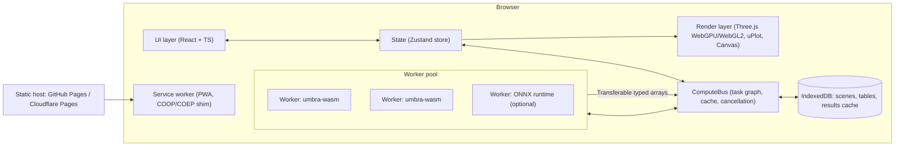
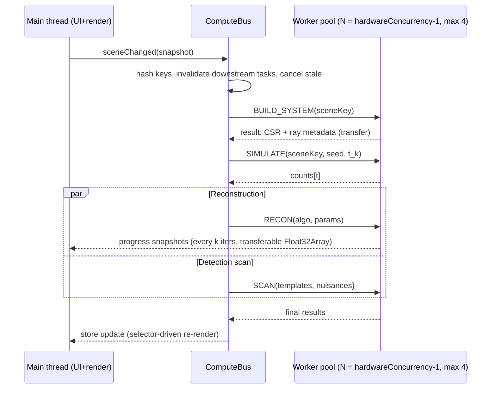

# UMBRA — An Interactive Muon-Tomography Observatory

**Design & Implementation Specification** · v0.1 (draft) · 18 November 2026
**Deliverable:** a static, serverless web application (Rust → WebAssembly compute core, TypeScript/WebGPU front end) hosted on GitHub Pages and/or Cloudflare Pages.

> *Codename "Umbra": the shadow that stone casts in the cosmic-ray sky. The app lets a visitor build a pyramid, hide a chamber in it, place particle detectors, watch muons rain down, and then do real inverse-problem science to decide whether the hidden void can be found, how confident one can be, and where to put the next detector.*

---

## Table of contents

1. [Vision, scope and success criteria](#1-vision-scope-and-success-criteria)
2. [Scientific background and mathematical formulation](#2-scientific-background-and-mathematical-formulation)
3. [Algorithm portfolio (frontier and esoteric components)](#3-algorithm-portfolio-frontier-and-esoteric-components)
4. [System architecture](#4-system-architecture)
5. [Compute core design (Rust/WASM)](#5-compute-core-design-rustwasm)
6. [Offline tooling and the Python reference oracle](#6-offline-tooling-and-the-python-reference-oracle)
7. [Front-end design](#7-front-end-design)
8. [Data, assets and scenario specification](#8-data-assets-and-scenario-specification)
9. [Build, CI/CD, hosting and deployment](#9-build-cicd-hosting-and-deployment)
10. [Testing, validation and benchmarking](#10-testing-validation-and-benchmarking)
11. [Implementation roadmap](#11-implementation-roadmap)
12. [Risk register](#12-risk-register)
13. [Repository layout, documentation and portfolio presentation](#13-repository-layout-documentation-and-portfolio-presentation)
14. [Appendices](#14-appendices)

---

## 1. Vision, scope and success criteria

### 1.1 Elevator pitch

Muon radiography images the inside of large structures using cosmic-ray muons. Because muons are absorbed by stone far more than by air, a hidden void shows up as an excess of particles from a particular direction. The 2017 ScanPyramids "Big Void" and the later North Face Corridor were found this way. Umbra turns that into a hands-on instrument:

- **Simulate** the physics (flux, energy loss, detector response, Poisson counting).
- **Reconstruct** density with limited-angle, photon-starved tomography.
- **Decide** statistically whether a void exists, with proper look-elsewhere correction.
- **Design** the experiment by asking where the next detector should go.
- **Play** by finding a hidden chamber in a "Mystery" mode.

### 1.2 Goals

| ID | Goal |
|----|------|
| G1 | A beautiful, fast, fully client-side web app that is understandable in 30 seconds and rewards 30 minutes. |
| G2 | A physically grounded forward model (cosmic-ray flux, energy loss, scattering, detector acceptance) with documented approximations. |
| G3 | A *portfolio* of reconstruction and inference methods that go beyond filtered back projection and are compared on identical data. |
| G4 | Honest statistics: calibrated significance, look-elsewhere correction, nuisance parameters, simulation-based calibration. |
| G5 | Experimental design as a first-class feature (optimal detector placement, time-to-discovery forecasts). |
| G6 | A rigorous engineering baseline: reference oracle, property tests, CI, benchmarks, size budgets, accessibility. |
| G7 | Zero running cost: static hosting, no accounts, no backend, offline-capable PWA. |
| G8 | Reproducibility: every scene and random stream is encoded in a shareable URL. |

### 1.3 Non-goals

- Not a predictor of real chambers in real monuments. Scenarios are schematic and clearly labelled as such.
- Not a full Geant4-class transport code. The physics is a validated *approximation* with documented error.
- No user accounts, server-side compute or paid services in the default deployment.
- No medical or safety-critical use.

### 1.4 Audiences and user journeys

| Persona | Journey | Experience they should have |
|---|---|---|
| Recruiter or engineer (2 min) | Land → scroll story → open Observatory → drag a detector → see the void appear | "This person can ship polished, technical work." |
| Physicist or imaging specialist (15 min) | Lab mode → compare solvers → inspect calibration plots and Methods page | "The statistics and inverse-problem treatment are real." |
| Student or curious visitor (10 min) | Learn chapters → Mystery mode → share a result | "I understood how muography works and had fun." |
| Hiring manager reading the repo | README → architecture → CI badges → benchmarks | "Clean architecture, strong testing discipline." |

### 1.5 Success criteria (measurable)

| Metric | Target |
|---|---|
| Time to first interaction (cold, mid laptop, broadband) | ≤ 3 s to landing hero; ≤ 6 s to interactive Observatory |
| Interactive responsiveness | Slider-driven updates ≤ 100 ms for 2D; ≤ 400 ms for 3D defaults |
| Frame rate | 60 fps desktop, ≥ 30 fps mid-range mobile with adaptive quality |
| Initial JS (landing route) | ≤ 250 KB gzip; lazy chunks for 3D, plots, WASM |
| WASM payload | ≤ 700 KB gzip (core) plus optional ≤ 1.5 MB ONNX models loaded on demand |
| Accessibility | Lighthouse a11y ≥ 95; keyboard-complete; reduced-motion honoured |
| Statistical calibration | Under H0, global false-positive rate within ±20% of nominal at 3σ across 10⁴ simulated datasets |
| Test coverage | ≥ 85% line coverage on Rust numerics; all headline algorithms have parity tests against the Python oracle |
| Cost | £0 / month |

### 1.6 Design principles

1. **Every pixel encodes data or intent.** No decorative-only effects; beauty comes from truthful physics visualisation.
2. **Show the uncertainty.** Never show a reconstruction without an indication of how much to believe it.
3. **Progressive disclosure.** Simple surface (drag, scrub, watch), deep layers (Lab, Methods, derivations) one click away.
4. **Deterministic and shareable.** Same URL, same universe.
5. **Fast by construction.** The problem is data-starved, not compute-starved (§4.8). Exploit that.
6. **Graceful degradation.** WebGPU → WebGL2 → static renders; threads → single worker; ONNX → classical-only.

---

## 2. Scientific background and mathematical formulation

### 2.1 Muography in one page

Cosmic rays striking the upper atmosphere produce showers of particles. At sea level the surviving charged particles are dominated by muons: roughly one per square centimetre per minute for a horizontal surface, with a strong dependence on zenith angle and a hard energy spectrum. Muons lose energy continuously while traversing matter, and a muon can cross a path only if its initial energy exceeds the *minimum energy* needed for the opacity along that path. A detector counting muons per direction therefore measures a function of the **opacity** (density integrated along the line of sight). A cavity lowers the opacity and raises the count in that direction.

Key practical consequences, all of which the app must reproduce:

- Dense, thick structures transmit only about 1% of muons or less, so exposure is measured in weeks or months.
- The signal is a *ratio* of void length to total path length, so small cavities are effectively invisible.
- Detectors sit at a few fixed places, so the data is **limited-angle** and **sparse-view**. Some structure is physically unrecoverable.
- Counts are Poisson, and low-energy backgrounds add a noise floor.

### 2.2 Notation

| Symbol | Meaning | Units |
|---|---|---|
| $\rho(\mathbf x)$ | Bulk density field | g cm⁻³ |
| $d$, $k$ | Detector index, angular bin index; $i=(d,k)$ a "ray cell" | — |
| $L_{ij}$ | Path length of ray cell $i$ through voxel $j$ | cm |
| $X_i=\sum_j L_{ij}\rho_j$ | Opacity along ray cell $i$ | g cm⁻² |
| $\theta_i,\varphi_i$ | Zenith and azimuth of ray cell $i$ | rad |
| $E_{\min}(X)$ | Minimum surface energy to traverse opacity $X$ | GeV |
| $I(E,\theta)$ | Differential muon intensity | cm⁻² s⁻¹ sr⁻¹ GeV⁻¹ |
| $\Phi(>E,\theta)=\int_E^\infty I\,dE'$ | Integral intensity | cm⁻² s⁻¹ sr⁻¹ |
| $\Delta\Omega_i$, $A_d$, $\varepsilon_d$, $T$ | Bin solid angle, detector area, efficiency, exposure | sr, cm², —, s |
| $y_i$, $\lambda_i$ | Observed and expected counts | — |
| $b_i$ | Background expectation (noise floor) | — |

### 2.3 Forward model

**Counts.**

$$\lambda_i(\rho)=T\,\varepsilon_d A_d\cos\theta_i\,\Delta\Omega_i\;\Phi\!\big(>E_{\min}(X_i(\rho)),\theta_i\big)+b_i,\qquad y_i\sim\mathrm{Poisson}(\lambda_i).$$

**Opacity.** $X_i=\sum_jL_{ij}\rho_j$. In memory $L$ is a sparse CSR matrix; the adjoint $L^\top$ is back projection. This is the same ray-integral operator and its adjoint as in the original CT lab, now from a *point* (the detector) over a restricted fan of directions instead of parallel views.

**Energy loss (continuous slowing-down approximation).** With $-dE/dX=a+bE$ (ionisation plus radiative losses) the minimum energy to traverse opacity $X$ is

$$E_{\min}(X)=\frac{a}{b}\left(e^{bX}-1\right).$$

Default constants for standard rock: $a\approx 2.0\times10^{-3}$ GeV cm² g⁻¹, $b\approx 4\times10^{-6}$ cm² g⁻¹ (critical energy $a/b\approx$ a few hundred GeV). The app can alternatively load tabulated range data (Groom–Mokhov–Striganov) generated offline (§6).

**Surface flux.** Modified Gaisser parametrisation with the large-angle correction of Guan et al. (2015):

$$I(E,\theta)=0.14\,E^{-2.7}\left[\frac{1}{1+\frac{1.1E\cos\theta^*}{115}}+\frac{0.054}{1+\frac{1.1E\cos\theta^*}{850}}\right],$$

with $E$ in GeV and $\cos\theta^*$ the effective-angle correction. *(Implementation note: transcribe the coefficients directly from the paper and unit-test against its published curves; do not rely on memory.)*

**Integral intensity table.** $\Phi(>E,\theta)$ is precomputed offline on a $(\log E,\cos\theta)$ grid and bilinearly interpolated in log space at runtime (§6.2). Closed-form derivatives follow from the fundamental theorem of calculus:

$$\frac{\partial\Phi(>E,\theta)}{\partial E}=-I(E,\theta),\qquad \frac{dE_{\min}}{dX}=a\,e^{bX}\;\Rightarrow\;\frac{\partial\lambda_i}{\partial X_i}=-K_i\,I\big(E_{\min}(X_i),\theta_i\big)\,a\,e^{bX_i},$$

where $K_i=T\varepsilon_d A_d\cos\theta_i\Delta\Omega_i$. This exact derivative drives every gradient-based method below.

**Fidelity levels** (selectable in the UI and encoded in each scenario):

| Level | Physics | Purpose |
|---|---|---|
| L0 | Beer–Lambert toy: $\lambda_i=K_i\Phi_0(\theta_i)\,e^{-X_i/\Lambda}+b_i$ | Fast baseline, classical transmission-tomography algorithms apply exactly, direct link to the original lab |
| L1 | Gaisser flux + CSDA range–energy relation (above) | Default; reproduces the "~1% transmission" regime |
| L2 | L1 + multiple-Coulomb-scattering angular blur (Highland), detector angular resolution, soft-particle background | Realistic degradation; makes small voids harder |

**Multiple scattering (L2).** For a muon of momentum $p$ crossing thickness $x$ (radiation length $X_0$, standard rock ≈ 26.5 g cm⁻²),

$$\theta_0=\frac{13.6\,\text{MeV}}{\beta c p}\sqrt{\tfrac{x}{X_0}}\left[1+0.038\ln\tfrac{x}{X_0}\right].$$

Implemented as an energy-weighted Gaussian convolution of expected counts across neighbouring angular bins (separable, cheap).

### 2.4 Inverse problems solved

| ID | Problem | Output |
|---|---|---|
| P1 | **Imaging.** Estimate $\rho(\mathbf x)$ from $y$ | Density volume plus uncertainty map |
| P2 | **Detection.** Is there an anomaly (void) beyond the reference structure? | Local and global significance map, time-to-discovery |
| P3 | **Characterisation.** Parametric void (position, size, orientation) | Posterior samples, Bayes factor vs no void |
| P4 | **Design.** Where to put detectors, how long to expose | Utility map, greedy placement, stopping rule |

### 2.5 Why this is hard (and interesting)

- **Limited angle.** The data lack large angular ranges, so there is a missing wedge in Fourier space and a nontrivial null space. Reconstructions elongate along unseen directions. The app visualises this explicitly (§3, A10).
- **Nonlinear Poisson model.** The counts depend on opacity through a non-exponential flux law, so classical linear tomography is not exact.
- **Systematics.** Bulk density, flux normalisation and detector efficiency are uncertain; they must be profiled out, not ignored.
- **Multiple testing.** Scanning many candidate positions inflates false positives (the look-elsewhere effect).

### 2.6 Documented approximations

1. **2D slice mode** treats rays as lying in the slice plane (a prism). Zenith dependence is retained; out-of-plane integration is omitted. 3D mode removes this.
2. **Point or small detectors.** Detector area enters through $K_i$; finite plate geometry optionally via 4–9 jittered sub-rays per bin.
3. **CSDA without range straggling** at L0/L1; stochastic fluctuations appear only in event-level Monte Carlo (A12).
4. **Homogeneous stone** with optional layered density; real pyramids have unknown inhomogeneity, handled as a nuisance (A6).
5. **Schematic geometry** for historical monuments (§8.3).

---

## 3. Algorithm portfolio (frontier and esoteric components)

The point is not to implement a single method but to implement a *family*, compare them honestly on the same data, and show where each breaks. Items marked ★ are the most distinctive for a portfolio.

| ID | Method | Role | Lineage / key refs | Risk | UI surface |
|---|---|---|---|---|---|
| A1 | **Transmission EM family** (Lange–Carson, OSTR, separable-paraboloidal-surrogates) | Classical Poisson baseline for L0 | Lange & Carson 1984; Erdoğan & Fessler 1999 | Low | Lab → solver race |
| A2 | **Direct nonlinear Poisson MAP**: L-BFGS-B with Huber-smoothed TV and box constraints, exact gradients | Main L1/L2 solver | Nocedal; Rudin–Osher–Fatemi | Low–Med | Reconstruct tab |
| A3 | **Opacity-domain pipeline**: invert counts to per-ray opacity with delta-method weights, then **Chambolle–Pock PDHG** with TV + box | Convex, robust alternative | Chambolle & Pock 2011 | Low | Reconstruct tab |
| A4 ★ | **Reference-anchored, one-sided sparse deviation**: $\rho=\rho_\text{ref}+\delta$, $-\rho_\text{ref}\le\delta\le0$, $\ell_1$-penalised via FISTA | Anomaly recovery; encodes "voids only remove material" | Beck & Teboulle 2009 | Med | Detect tab |
| A5 | **Plug-and-Play / RED prior** with a small learned denoiser (ONNX) | Learned regularisation (stretch) | Venkatakrishnan 2013; Romano 2017 | High | Lab (optional) |
| A6 ★ | **Profile-likelihood scan**: score-test/GLRT over a multi-scale template bank, **Asimov** significance, nuisance-parameter profiling, **Euler-characteristic look-elsewhere** correction | Calibrated detection | Cowan et al. 2011; Gross & Vitells 2010 | Med | Detect tab |
| A7 ★ | **Parametric Bayesian void inversion** with an *analytic chord* forward model (ray–ellipsoid/box intersections, no re-voxelisation), **affine-invariant ensemble MCMC**, **nested sampling** for the Bayes factor | Posterior over void parameters; model selection | Goodman & Weare 2010; Skilling 2006 | Med | Detect → Characterise |
| A8 ★ | **Sequential testing**: sequential GLR/mixture-SPRT, closed-form time-to-discovery forecast $t_{5\sigma}\approx25/r$ | "How long until we know?" | Wald 1945 | Low–Med | Timeline |
| A9 ★ | **Bayesian-optimal experimental design** with Asimov expected-discovery utility, monotone-submodular greedy placement | Next-best detector | Chaloner & Verdinelli 1995; Nemhauser et al. 1978 | Med | Design tab |
| A10 ★ | **Visibility and resolution analysis**: Fisher-information sensitivity map, local PSF via CG, stochastic diagonal probing, per-voxel angular coverage rose, Lanczos null-space modes | Shows what the geometry *cannot* see | Fessler & Rogers 1996 | Med | Lab → Visibility |
| A11 | **Uncertainty**: Laplace/Fisher covariance, parametric bootstrap, **simulation-based calibration (SBC)** | Trustworthy error bars | Talts et al. 2018 | Low–Med | All result cards |
| A12 | **Event-level Monte Carlo muon transport** (sampling $E,\theta$ from the flux, voxel traversal, optional stochastic loss) | Visualisation and validation of expected counts | — | Low | 3D muon rain |
| A13 ★ | **Neural posterior estimation (amortised SBI)** for void parameters: a conditional flow or mixture-density network trained offline on Rust-generated simulations, run via ONNX Runtime Web, validated with SBC/TARP | Instant posterior vs MCMC comparison (stretch) | Cranmer et al. 2020; Lemos et al. 2023 | High | Lab (optional) |

**Correction on terminology.** Earlier project discussions referred to MLEM/OSEM. Strictly, those solve *emission* models $y\sim\mathrm{Pois}(A\rho)$. Muon counts are *transmission-type* (decreasing with opacity), so the matching classical family is the ML-transmission methods in A1. A2/A3 handle the full nonlinear flux law.

**Novelty claim, carefully stated.** Each method exists in the literature. The contribution is (i) a single, browser-native, interactive platform that exposes the whole chain from physics to calibrated decision to experiment design; (ii) the one-sided anomaly prior, profile-likelihood scan with Euler-characteristic trial factors, and Asimov-utility detector placement applied to muography; (iii) a transparent solver and calibration comparison. Verify the literature before using "first" in public copy.

---

## 4. System architecture

### 4.1 Architectural principles

1. **Compute core is a plain Rust library**, with no web dependencies, usable natively (CLI, benchmarks, dataset generation) and compiled to WASM unchanged.
2. **Thin façade.** The WASM crate only marshals data. All logic lives in testable crates.
3. **Everything heavy runs off the main thread**, in a pool of workers that need no shared memory.
4. **Dataflow, not callbacks.** A task graph with content-hash cache keys, cancellation and progressive results.
5. **Immutable scene snapshots.** UI edits produce a new `SceneSpec`; compute tasks consume snapshots.
6. **Determinism.** Seeded counter-based RNG streams; identical URLs reproduce identical universes.

### 4.2 Context diagram



### 4.3 Layers and responsibilities

| Layer | Tech | Responsibility | Must not |
|---|---|---|---|
| Presentation | React 19, Tailwind v4, Radix primitives, Framer Motion | Layout, controls, narrative, accessibility | Perform numerics |
| Rendering | Three.js (WebGPURenderer with WebGL2 fallback), custom shaders, uPlot/D3 | 3D scene, volume rendering, sky maps, plots | Own application state |
| State | Zustand + Immer, URL codec | Scene, detectors, physics level, exposure, UI, game | Call WASM directly |
| Orchestration | `ComputeBus`, Comlink | Task scheduling, caching, cancel, progress | Contain science |
| Compute | Rust crates → WASM | All physics, solvers, statistics, design | Touch the DOM |
| Offline tooling | Python, Rust CLI | Table generation, oracle, SBI training, benchmarks | Ship to the browser except as assets |

### 4.4 Threading and concurrency model



- **Task-parallel, not data-parallel.** MCMC chains, bootstrap replicates, null simulations for look-elsewhere calibration and multi-scale scans are embarrassingly parallel across workers. This needs **no SharedArrayBuffer**, so the app works on GitHub Pages without cross-origin isolation.
- **Optional "Turbo" build** uses `wasm-bindgen-rayon` (needs nightly Rust, SharedArrayBuffer and COOP/COEP) for intra-task parallel solver kernels. Loaded only if `crossOriginIsolated` is true.
- **SIMD.** Two WASM binaries (with and without `simd128`) are selected via `wasm-feature-detect`.
- **WebGPU compute (optional)** is used for (a) muon-rain particle update and (b) volume-render transfer; numerics stay in WASM for portability and testability.

### 4.5 Task graph, caching and invalidation

Each task has a **content key** (hash of its inputs). Results are memoised in memory and, for expensive ones, in IndexedDB.

| Task | Inputs (key) | Output | Typical latency (target) | Cancellable |
|---|---|---|---|---|
| `LOAD_TABLES` | table version | Flux/range tables | < 50 ms (cached) | no |
| `BUILD_SYSTEM` | scene geometry, detectors, bins | CSR `L`, ray meta | 2D: 10 ms · 3D: 150–500 ms | yes |
| `EXPECTED` | system, physics level, ρ (ref or alt) | $\lambda$ (H0/H1) | 1–5 ms | yes |
| `SIMULATE` | expected, seed, $t$ | counts (coupled Poisson) | 1–10 ms | yes |
| `RECON` | counts, algorithm, params | density snapshots | 2D: 20–500 ms · 3D: 0.5–5 s | yes (per-iteration) |
| `SCAN` | counts, template bank, nuisances | local TS, Z, α̂ maps | 2D: 50 ms · 3D: 0.3–2 s | yes |
| `LEE_CALIB` | scan config | global p-value curve | 1–10 s (parallel, cached) | yes |
| `MCMC` | counts, void param prior | samples, evidence | 5–30 s (parallel chains) | yes |
| `DESIGN` | scene, candidate poses, prior | utility map, greedy order | 0.2–3 s | yes |
| `PSF` | system, Fisher, voxel | local PSF, coverage rose | 5–50 ms | yes |
| `EVENT_MC` | scene, seed, N | track arrays for rendering | 50–300 ms per 65k tracks | yes |

**Invalidation rule:** a change of node *n* invalidates every descendant; cancellation tokens are checked inside inner loops every ≤ 5 ms of work (`should_stop()`), keeping UI latency bounded.

### 4.6 Rust ↔ JavaScript contract

- `wasm-bindgen` for the bridge; `tsify` generates TypeScript types from Rust structs; `serde-wasm-bindgen` for small config objects.
- **Bulk data never passes through serde.** Large arrays use `Float32Array`/`Uint32Array` views over WASM memory on the worker side and are *transferred* (not copied) to the main thread.
- **Versioned API:** `umbra-wasm` exports `api_version()`; the TS client asserts compatibility.
- **Errors:** Rust returns `Result<T, UmbraError>`; the façade converts to a discriminated union `{ok:true,...}|{ok:false,code,message}`. No panics cross the boundary (`panic = "abort"` plus a hook that posts diagnostics).

```ts
// web/src/compute/protocol.ts
export type TaskKind =
  | 'LOAD_TABLES' | 'BUILD_SYSTEM' | 'EXPECTED' | 'SIMULATE' | 'RECON'
  | 'SCAN' | 'LEE_CALIB' | 'MCMC' | 'DESIGN' | 'PSF' | 'EVENT_MC';

export interface TaskRequest<K extends TaskKind = TaskKind> {
  id: string;            // uuid
  kind: K;
  key: string;           // content hash of inputs
  priority: 0 | 1 | 2;   // 0 = interactive, 2 = background
  payload: PayloadOf<K>;
}

export type TaskEvent =
  | { id: string; type: 'progress'; frac: number; snapshot?: ArrayBufferView; meta?: unknown }
  | { id: string; type: 'result'; result: ResultOf<TaskKind>; transfer?: ArrayBuffer[] }
  | { id: string; type: 'error'; code: string; message: string };
```

### 4.7 Determinism and randomness

- RNG: **PCG64-DXSM** or **Philox-4x32** (counter-based), implemented in-crate (small, WASM-friendly).
- A **stream id** is derived as `H(sceneKey, taskKind, index)`, so any task, worker or replicate is reproducible regardless of scheduling.
- **Coupled Poisson process for time scrubbing.** To make the exposure slider monotone and stable, counts at exposure $t$ are generated by *checkpointed binomial bridging*: counts are pre-drawn at ~64 log-spaced checkpoint times via independent Poisson increments; any intermediate $t$ is obtained by binomial thinning between neighbouring checkpoints using a seed derived from `(cell, checkpoint)`. Counts never decrease as $t$ grows and scrubbing backwards reproduces the same history.

### 4.8 Why the browser is feasible: the problem is data-starved

| Quantity | 2D default | 3D default |
|---|---|---|
| Grid | 128 × 128 (16 k cells) | 64³ (262 k voxels), up to 96³ on desktop |
| Detectors | 1–6 | 1–6 |
| Angular bins per detector | 180–360 | 72 az × 36 zen ≈ 2.6 k |
| Ray cells total | ≈ 1–2 k | ≈ 4–16 k |
| Non-zeros in $L$ | ≈ 10⁵ | ≈ 5×10⁵ – 2×10⁶ |
| Memory for CSR | < 2 MB | < 25 MB |

A CSR matvec of ~10⁶ non-zeros takes a few milliseconds in WASM, so a full solver run is measured in seconds even in 3D. The scarce resource is *information*, not flops.

---

## 5. Compute core design (Rust/WASM)

### 5.1 Workspace layout

```
crates/
  umbra-core      # grids, geometry, rays, CSR, RNG, interpolation, linear algebra helpers
  umbra-physics   # flux, range-energy, scattering, tables, detector model, event MC
  umbra-forward   # system builder, forward/adjoint, gradients, analytic chord models
  umbra-recon     # A1–A5 solvers, priors, proximal operators
  umbra-stats     # A6, A8, A11: scans, Asimov, LEE, SPRT, bootstrap, SBC
  umbra-infer     # A7: ensemble MCMC, nested sampling, parametric void models
  umbra-design    # A9: utilities, greedy/submodular placement
  umbra-vis       # A10: Fisher diag, local PSF, Lanczos modes, coverage roses
  umbra-wasm      # wasm-bindgen façade, task entry points, cancellation
  umbra-cli       # native tools: table gen, simulation dump for SBI, benchmarks, parity runner
```

Dependency rule: `core ← physics ← forward ← {recon, stats, infer, design, vis} ← wasm`. No cycles; only `wasm` and `cli` are leaf crates.

### 5.2 Core data structures

```rust
// umbra-core
pub struct Grid3 { pub n: [u32; 3], pub origin: [f32; 3], pub h_m: f32 }   // cubic voxels, metres
pub struct Grid2 { pub n: [u32; 2], pub origin: [f32; 2], pub h_m: f32 }

pub enum Primitive {                  // analytic shapes used for scenes, voids and templates
    Box     { c: [f32;3], half: [f32;3], rot: Quat },
    Ellip   { c: [f32;3], semi: [f32;3], rot: Quat },
    Capsule { a: [f32;3], b: [f32;3], r: f32 },     // corridors
    Prism2D (/* polygon + extent */),
}

pub struct Csr<T> { pub indptr: Vec<u32>, pub indices: Vec<u32>, pub data: Vec<T> }

// umbra-physics
pub struct Detector {
    pub pose: Pose,                   // position + orientation (plate normal)
    pub area_m2: f32, pub eff: f32,
    pub binning: AngularBinning,      // az/zen ranges and counts, or 2D angle bins
    pub sigma_ang_mrad: f32,          // detector angular resolution (L2)
    pub bg_rate_hz: f32,              // soft-particle/noise floor (L2)
}

// umbra-forward
pub struct RayCell { pub det: u16, pub zen: f32, pub az: f32, pub k_scale: f32 /* K_i/T */ }
pub struct System { pub l: Csr<f32> /* cm */, pub rays: Vec<RayCell>, pub grid: GridAny }
```

### 5.3 Ray traversal and system-matrix assembly

- **3D/2D DDA (Amanatides–Woo)**, equivalent to Siddon's method, yields exact path lengths $L_{ij}$ per voxel. Sub-ray jittering (default 1; up to 9) averages over detector area and bin width.
- **Assembly is data-parallel over rays**, with each worker/thread writing a CSR row; deterministic ordering via row index.
- **Matrix-free alternative** (`impl LinearOperator`) recomputes traversal on the fly, used for the 96³+ "high-quality" mode to cap memory.
- **Oracle test:** for box, triangle-prism and ellipsoid targets, $L\rho$ equals the analytic chord through the shape (and equals the original lab's `scipy.integrate.quad` line integrals to tolerance).

```rust
pub trait LinearOperator {
    fn nrows(&self) -> usize; fn ncols(&self) -> usize;
    fn apply(&self, x: &[f32], y: &mut [f32]);       // y = A x
    fn apply_t(&self, y: &[f32], x: &mut [f32]);     // x = Aᵀ y (back projection)
}
```

A built-in **dot-product test** `⟨Ax, y⟩ = ⟨x, Aᵀy⟩` runs in debug builds and CI for every operator.

### 5.4 Physics module

```rust
pub struct FluxTable { /* log10 E_min axis, cosθ axis, Φ(>E,θ) values, dΦ/dE values */ }
impl FluxTable {
    pub fn integral(&self, e_min_gev: f32, cos_theta: f32) -> f32;   // bilinear in log space
    pub fn diff(&self, e_gev: f32, cos_theta: f32) -> f32;            // I(E,θ)
}
pub fn e_min(x_gcm2: f32, a: f32, b: f32) -> f32 { (a / b) * ((b * x_gcm2).exp_m1()) }
pub fn de_min_dx(x_gcm2: f32, a: f32, b: f32) -> f32 { a * (b * x_gcm2).exp() }
```

`expected(system, rho, level)` evaluates $\lambda_i$ and optionally $\partial\lambda_i/\partial X_i$. At L2 the output is convolved with the angular blur kernel (separable), and the gradient is the transpose of that convolution (symmetric kernels make this the same convolution).

### 5.5 Reconstruction (A1–A5)

**Common objective (A2).**

$$\min_{\rho\in[0,\rho_{\max}]}\;J(\rho)=\sum_i\big[\lambda_i(\rho)-y_i\ln\lambda_i(\rho)\big]+\beta\,\mathrm{TV}_\epsilon(\rho),$$

with gradient

$$\nabla J=L^\top\!\Big[\big(1-\tfrac{y_i}{\lambda_i}\big)\tfrac{\partial\lambda_i}{\partial X_i}\Big]_i+\beta\nabla\mathrm{TV}_\epsilon.$$

Solved with **L-BFGS-B** (box constraints via projected quasi-Newton). Huber-smoothed isotropic TV keeps $J$ differentiable. Optional **Fisher-scoring** warm start (a few preconditioned CG steps on the Gauss–Newton system) speeds early iterations.

**A1 (L0 only): ordered-subset transmission methods.** SPS/OSTR updates with Erdoğan–Fessler optimal curvatures. Included to show the classical lineage and as the quickest baseline.

**A3: opacity-domain + PDHG.**

1. Invert counts to per-ray opacity: $\hat X_i=g_i^{-1}(y_i)$ with $g_i(X)=\lambda_i$ monotone; solve by safeguarded Newton. Zero counts use a continuity correction (add 0.5, or use the Bayesian posterior mean under a Gamma prior).
2. Weights from the delta method: $w_i=\big(\partial\lambda_i/\partial X_i\big)^2/\lambda_i$.
3. Solve the convex problem

$$\min_\rho\;\tfrac12\|W^{1/2}(L\rho-\hat X)\|_2^2+\beta\|\nabla\rho\|_{2,1}+\iota_{[0,\rho_{\max}]}(\rho)$$

with **Chambolle–Pock**: primal–dual step sizes $\sigma\tau\|K\|^2<1$ for $K=[L;\nabla]$, with $\|K\|$ by power iteration; over-relaxation $\theta=1$; convergence monitored by the primal–dual gap.

**A4: reference-anchored one-sided sparse deviation.** With known structure $\rho_\text{ref}$ (the pyramid plus its known chambers) write $\rho=\rho_\text{ref}+\delta$. Unknown cavities can only *remove* material, so $-\rho_\text{ref}\le\delta\le0$. Then $\|\delta\|_1=-\mathbf 1^\top\delta$, and the FISTA proximal step has a closed form:

$$\mathrm{prox}_{t\mu}(z)=\min\!\big(0,\max(-\rho_\text{ref},\,z+t\mu)\big).$$

Add a TV-on-$\delta$ variant for blocky voids. An optional "dense inclusion" mode flips the sign constraint to $\delta\ge0$ (for granite blocks or fill).

**A5 (stretch): Plug-and-Play.** ADMM or proximal gradient with the denoiser $D_\sigma$ as the prior step; $D_\sigma$ is a small U-Net exported to ONNX, trained on synthetic pyramids with random voids. Runs in an ONNX worker; always compared with A2–A4 and clearly labelled as *learned*.

```rust
pub trait Solver {
    type Config;
    fn init(op: &dyn ForwardOp, data: &Counts, cfg: &Self::Config) -> Self;
    fn step(&mut self, ctl: &mut Control) -> StepReport;   // one iteration (or one subset sweep)
    fn estimate(&self) -> &[f32];                          // current ρ
}
pub struct Control { /* cancel token, iteration budget, snapshot cadence */ }
```

### 5.6 Detection statistics (A6, A8, A11)

**Hypotheses.** $H_0$: reference structure only. $H_1(c,s)$: an additional void template of centre $c$, scale $s$, amplitude $\alpha\in[0,1]$ (fraction of density removed).

**Score statistic via back projection.** For small $\alpha$, $\lambda_i(\alpha)\approx\lambda_i^0+\alpha g_i$, $g_i=\rho\,(L t_c)_i\,\big(-\partial\lambda_i/\partial X_i\big)\ge0$. The score and Fisher information are

$$U_c=\sum_i g_i\frac{y_i-\lambda_i^0}{\lambda_i^0},\quad I_c=\sum_i\frac{g_i^2}{\lambda_i^0},\quad Z_c=\frac{U_c}{\sqrt{I_c}},\quad \hat\alpha_c\approx\frac{U_c}{I_c}.$$

Defining the residual field $s_i=-\frac{\partial\lambda_i}{\partial X_i}\frac{y_i-\lambda_i^0}{\lambda_i^0}$, the numerator is $U_c=\rho\,\sum_j t_c(j)\,(L^\top s)_j$: **the back projection of weighted residuals, correlated with the template**. A multi-scale scan is therefore one back projection plus separable box/Gaussian correlations (integral images or FFT). That is the same CT back-projection adjoint, now used as a detector of anomalies.

**Exact LRT refinement.** For the top-$K$ candidates compute $\mathrm{TS}=2\sum_i[y_i\ln(\lambda_i(\hat\alpha)/\lambda_i^0)-(\lambda_i(\hat\alpha)-\lambda_i^0)]$ with $\hat\alpha\in[0,1]$ found by Newton with clamping. Because $\alpha\ge0$ is on the boundary under $H_0$, the null distribution of TS is $\tfrac12\delta_0+\tfrac12\chi^2_1$, so one-sided $p=\tfrac12P(\chi^2_1>\mathrm{TS})$.

**Template-footprint evaluation.** Computing $I_c$ for $\sim10^6$ candidates is the bottleneck. Each template only affects ray cells within its angular footprint at each detector, so a per-detector **angular spatial index** restricts the sum to ~50 cells per detector and brings the 3D cost to ~10⁸ operations.

**Nuisance parameters.** Bulk-density scale $\kappa_\rho$, flux normalisation $\kappa_\Phi$, detector efficiencies $\kappa_{\varepsilon,d}$, small alignment offsets: each has a Gaussian prior. The test statistic is the **profile likelihood ratio**, with nuisances re-fitted under $H_0$ and $H_1$ by a short damped Newton iteration on a $\le$ 6-dimensional problem. The Detect tab has a "Systematics" panel to switch these on and watch significance fall.

**Asimov significance.** The median expected significance under $H_1$ uses the Asimov dataset $y\leftarrow\lambda^1$:

$$\mathrm{TS}_A=2\sum_i\Big[\lambda_i^1\ln\frac{\lambda_i^1}{\lambda_i^0}-(\lambda_i^1-\lambda_i^0)\Big],\qquad Z_A=\sqrt{\mathrm{TS}_A}.$$

$\mathrm{TS}_A$ is linear in exposure, so $Z_A\propto\sqrt t$, which gives the time to a $5\sigma$ median discovery: $t_{5\sigma}=25\,t_0/\mathrm{TS}_A(t_0)$.

**Look-elsewhere (global significance).** Two layers:

1. *Monte Carlo calibration.* Simulate $N_0\approx2000$ background-only datasets in parallel workers, record $\max_c Z_c$, and build an empirical null for the maximum.
2. *Euler-characteristic extrapolation (Gross–Vitells).* From a few dozen null fields at a low threshold $u_0$, estimate the mean Euler characteristic of the excursion set and extrapolate to high $u$ using the known $\chi^2$-field scaling, giving global p-values at $5\sigma$ without $10^7$ simulations.

**A8 Sequential decision.** Maintain a running log-likelihood-ratio (mixture over templates) with Wald-style boundaries. The Timeline shows the boundary and the stopping time, plus a forecast ribbon for when the boundary is expected to be crossed.

**A11 Uncertainty.** Fisher/Laplace covariance for fast approximate error bars. **Parametric bootstrap** (resample Poisson counts from the fitted model, re-solve): pixel-wise standard-deviation map. **SBC rank histograms** shown in the Lab for the inference engines.

### 5.7 Parametric Bayesian inversion (A7)

- **Parameters** $\theta=(c_x,c_y,c_z,a,b,c,\phi,\psi)$ for an ellipsoid, or box/capsule variants; priors from the scene (the void must lie inside the stone and be larger than the minimum size).
- **Analytic-chord forward model.** The opacity change is $X_i(\theta)=X_i^\text{ref}-\rho_\text{stone}\,\ell_i(\theta)$, where $\ell_i$ is the chord length of ray $i$ through the primitive (closed-form quadric intersection). No re-voxelisation: one likelihood evaluation costs $O(\text{rays})\approx 10^4$ flops.
- **Sampler:** Goodman–Weare affine-invariant ensemble (32–64 walkers). Chains are independent, so they spread across workers. Diagnostics: integrated autocorrelation time, split-$\hat R$.
- **Evidence:** nested sampling (400 live points, slice-sampling moves) gives $\ln Z$ for "one void" vs "none" and hence the Bayes factor, shown next to the frequentist Z with an explicit warning that they answer different questions.
- **Outputs:** corner plot (WebGL scatter matrix), marginal intervals, posterior-predictive sky map, and a **posterior probability volume** rendered in 3D ("where is the void, as a cloud").

### 5.8 Experimental design (A9)

- **Candidate poses** $\mathcal P$: from the scenario's allowed-location graph (chambers, corridors, ground ring), plus orientations.
- **Hypothesis set** $\mathcal H=\{h_m\}$ with prior weights $\pi_m$ (void positions × sizes, or the posterior from the current data, giving *sequential* design).
- **Utility of a configuration $S$**:
$$U(S)=\sum_m\pi_m\,f\!\Big(\sum_{p\in S}\mathrm{TS}_A(p;h_m)\Big),\qquad f(x)=1-e^{-x/\kappa}.$$
Log-likelihoods add across independent detectors, and $f$ is concave increasing, so $U$ is monotone submodular and **greedy selection is within $1-1/e$ of optimal**.
- **Alternatives:** worst-case (E-optimal) utility $\min_m$; D-optimal via the Fisher determinant for the parametric model.
- **UI:** a glowing utility heat-map over allowed locations; "Suggest next detector" button; side-by-side of greedy vs user placement with the resulting time-to-5σ.

### 5.9 Visibility and resolution (A10)

- **Sensitivity map:** $F_{jj}=\sum_iL_{ij}^2\,w_i$ (Fisher diagonal), with $w_i=(\partial\lambda_i/\partial X_i)^2/\lambda_i$.
- **Local PSF at voxel $j$:** solve $(L^\top WL+\beta R)\,p=L^\top WL\,e_j$ by a handful of CG iterations; hover any voxel to see its blur.
- **Resolution-matrix diagonal** via stochastic probing (Hutchinson-style with structured probes).
- **Null-space modes:** Lanczos on $W^{1/2}L$ gives the leading singular vectors; the *smallest* singular vectors are the modes the experiment cannot see.
- **Angular coverage rose:** per-voxel histogram of ray directions through it; its complement is the **missing wedge**, linking directly to the Fourier-slice picture from the CT lab.

### 5.10 Event-level Monte Carlo (A12)

For each sampled muon draw $\cos\theta$ and $E$ from $I(E,\theta)$ (inverse-CDF tables), traverse the voxel grid accumulating opacity, and declare survival if $E>E_{\min}(X_{\text{path}})$ (optionally with a stochastic radiative-loss correction). Returns packed arrays `[x0,y0,z0, dx,dy,dz, stop_dist, fate]` for the renderer. A chi-squared test confirms MC counts per detector bin agree with $\lambda_i$ (a CI test).

### 5.11 Performance engineering

- `f32` throughout; `f64` accumulators for reductions and log-likelihoods.
- Struct-of-arrays layouts; CSR row-block partitioning for cache locality.
- `simd128` for matvec and elementwise kernels; scalar fallback behind the same trait.
- Preallocated workspaces; no allocation in inner loops.
- Release profile: `opt-level=3`, `lto="fat"`, `codegen-units=1`, `panic="abort"`, followed by `wasm-opt -O3`.
- `criterion` benchmarks for each kernel, tracked in CI with regression thresholds.

